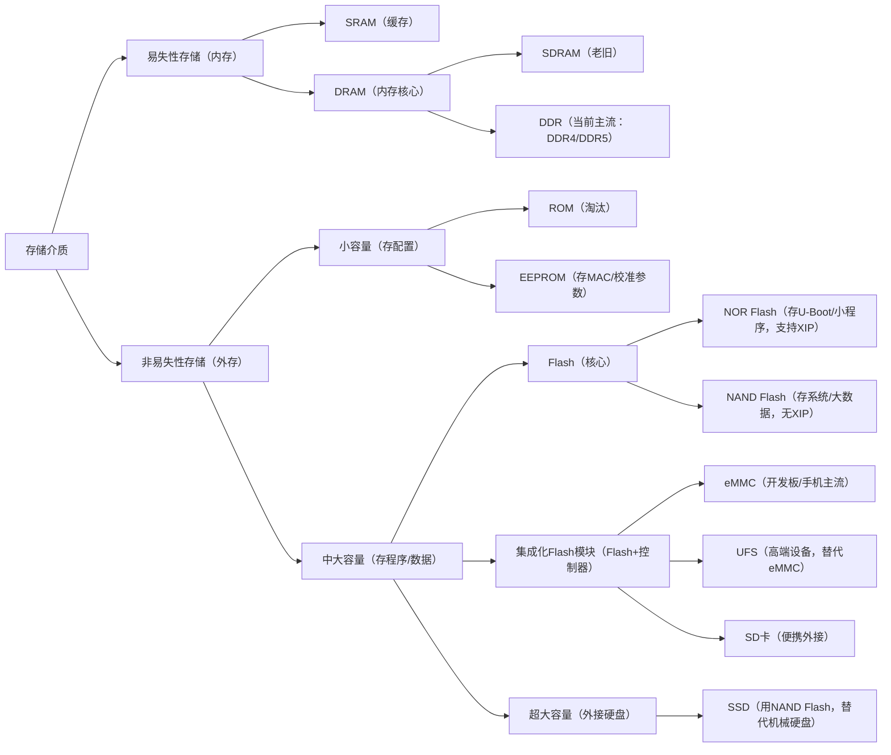

# 存储器层次结构


> [!CAUTION]
>
> 1. 有的教材把安装在电脑内部的磁盘称为辅存，把U盘、光盘等称为外存。也有的教材把磁盘、U盘、光盘等统称为辅存或外存。
> 2. 辅存中的数据要调入主存后才能被CPU访问，主存——辅存层的数据交换由硬件+操作系统完成，实现了虚拟存储系统，解决了主存容量不够的问题。
> 3. Cache——主存由硬件自动完成，解决主存与CPU容量不匹配的问题。

# 存储器多种分类

- **按层次分类**
  见层次结构
- **按存储介质**
  
  ```txt
  半导体        （主存，Cache）
  磁性材料存储器 （磁盘，磁带）
  光存储器       （光盘）
  ```
- **按存取方式**
  随机存取存储器（RAM）
  顺序存储器(SAM) ：如磁带
  直接存取存储器（DAM）：如机械硬盘，相联存储器
  按内容访问的存储器（CAM）：如快表。
- **按信息的可更改性**
  读写存储器
  只读存储器（ROM）。
- **按信息的可保存性****
  易失性存储器，非易失性；
  破坏性读出，非破坏性读出。

# 存储器性能指标

1. **存储容量**
   存储字数*字长
2. **单位成本**
   每位价格=总成本/总容量
3. **存储速度**
   数据传输率=数据的宽度/存储周期

# 存储介质总框架

## 1.核心分类

所有存储介质，本质都是存数据的容器，但最根本的区别是断电后数据会不会丢。

| 分类                 | 核心特点           | 核心用途                    |
| -------------------- | ------------------ | --------------------------- |
| 易失性存储（内存）   | 断电后数据立即丢失 | 临时存正在运行的程序 / 数据 |
| 非易失性存储（外存） | 断电后数据长期保留 | 长期存程序 / 静态数据       |

### 3.`SRAM`和`DRAM`对比


## 2.易失性存储（内存）

这类存储**速度极快**（跟 CPU 速度匹配），但**容量小、成本高**，只能临时用，核心是支撑程序运行。

| 介质         | 概念与特点                                                   | 速度对比               | 用途                                      | 场景应用                                                     |
| ------------ | ------------------------------------------------------------ | ---------------------- | ----------------------------------------- | ------------------------------------------------------------ |
| SRAM         | 静态随机存取存储器（Static RAM）：无需刷新电路，速度最快，但成本极高、容量小 | 最快（纳秒级）         | CPU 的L1/L2/L3 缓存                       | 1. 比如 STM32 的内部SRAM（几 KB~ 几十 KB），程序运行时临时存变量； 2. Linux 开发板的CPU 内置的缓存，加速数据读取（用户看不到，硬件自动用）。 |
| **DRAM**     | 动态随机存取存储器（Dynamic RAM）：需定时刷新（耗电），速度比 SRAM 慢，成本低、容量大 | 比 SRAM 慢（几十纳秒） | 电脑的内存原型                            | 所有需要大容量临时存储的场景，是内存的核心类型，下面的 SDRAM、DDR 都是它的升级款。 |
| ├─ **SDRAM** | 同步动态 RAM（Synchronous DRAM）：与 CPU 时钟同步，比早期 DRAM 快，是 DDR 的前身 | 比 DRAM 快             | 早期电脑 / 开发板的内存                   | 老旧 Linux 开发板（如 2010 年前的 ARM9 板），现在基本被 DDR 取代。 |
| └─ **DDR**   | 双倍数据速率 SDRAM（Double Data Rate SDRAM）：在 SDRAM 基础上翻倍带宽，是当前主流 | 比 SDRAM 快 2 倍 +     | 现在电脑的 DDR4/DDR5 内存、手机的运行内存 | 1. Linux 开发板的核心内存（比如 RK3568 板的 2GB DDR4），启动时 U-Boot 把 Linux 内核加载到 DDR 中运行，应用程序的临时数据也存在这里；2.高端单片机（如 STM32H7）也支持外接 DDR，跑复杂程序。 |

## 3.非易失性存储（外存）

这类存储**速度慢**（比内存慢 100~1000 倍），但**容量大、成本低、断电存数据**，核心是长期保存程序和静态数据。按 容量 + 擦写方式再细分：

### 1.小容量

主要用于存配置 / 小程序。

| 介质         | 概念与特点                                                   | 容量范围                     | 擦写方式                                                     | 场景应用                                                     |
| ------------ | ------------------------------------------------------------ | ---------------------------- | ------------------------------------------------------------ | ------------------------------------------------------------ |
| **ROM**      | 只读存储器（Read-Only Memory）：出厂时一次性写入，之后只能读，不能改 | 几 KB~ 几 MB                 | 不可擦写                                                     | 几乎淘汰，仅在极老旧设备（如早期 51 单片机）中用，现在被 EEPROM/Flash 取代。 |
| **Mask ROM** | 数据在芯片制造时由掩膜工艺永久写入，用户完全无法修改。特点是可靠性极高、成本极低（大批量时），但灵活性为零 | 从几Kb到数Mb                 | 不可擦写                                                     | 仅适用于程序绝对固化、百万级大批量生产的产品，如早期的游戏机卡带、固定功能的消费电子。 |
| **PROM**     | 出厂时全为空，用户可用编程器（烧录器）**一次性**写入数据。写入后永久固定，无法修改。成本比掩膜ROM高，但比可擦写型便宜。 | 较小，通常在数十Kb到数Mb级别 | 一次写入，不可擦除。通过烧断芯片内部熔丝或击穿PN结实现编程   | 产品定型前的**小批量试产**，或对成本极度敏感且无需升级的成熟产品 |
| **EPROM**    | 写入后，数据可保存数年。需要修改时，需将芯片取下，用强紫外线照射以擦除全片数据，然后重新写入。灵活度比PROM高，但操作繁琐 | 典型容量在 2KB 到 1MB 之间   | 紫外线全片擦除，再用电脉冲写入。擦除需 15-30 分钟，可重复擦写数千次 | 主要用于早期的软件开发与调试阶段，或小批量生产，现已被Flash取代 |
| **EEPROM**   | 电可擦除 ROM（Electrically Erasable ROM）：电擦写（无需拆芯片），按字节擦写，速度慢、容量小 | 几十字节～几 KB              | 字节级擦写                                                   | 1. 单片机的存硬件配置（如 STM32 的 I2C EEPROM，存校准参数）； 2. Linux 开发板比如存网卡 MAC 地址、BIOS 配置（部分老板）。 |

### 2.中大容量

Flash是EEPROM的进化版，容量大、成本低、读写速度快。但操作方式较粗放，**按“扇区/块”擦除**，不能单字节随意改。主要用于存程序 / 系统 / 大数据—— 核心是 Flash，Flash（闪存）是当前主流，按存储结构分为 **NOR Flash** 和 **NAND Flash**，两者是 兄弟但用途完全不同，是开发板 / 单片机的核心存储。

| 介质           | 概念与特点                                                   | 容量范围       | 擦写方式   | 关键能力               |
| -------------- | ------------------------------------------------------------ | -------------- | ---------- | ---------------------- |
| **NOR Flash**  | 按页读、按扇区擦写，**支持 XIP（原地执行）**（CPU 直接读 Flash 运行程序），速度快（读）、成本高 | 几 MB~ 几百 MB | 扇区级擦写 | 支持 XIP（核心优势）   |
| **NAND Flash** | 按块擦写，**不支持 XIP**（程序必须加载到 RAM 才能运行），速度慢（读）、容量大、成本低，有坏块问题（需管理） | 几十 MB~ 几 TB | 块级擦写   | 大容量存储（核心优势） |

### 3.NOR和NAND区别

NOR Flash 和 NAND Flash 虽然同属闪存，但NOR 为可靠地执行代码而生，NAND 为廉价地存储数据而生。两者的区别可以从以下几个维度展开。

#### 1.内部结构与寻址方式

- **NOR Flash**
  采用并行结构，每个存储单元独立连接到位线，支持随机访问。芯片有完整的地址线和数据线，CPU 可以直接按地址读取任意字节，无需先读取整个块。
- **NAND Flash**
  采用串联结构，存储单元首尾相连，共享位线。这种结构密度极高，但不支持随机字节访问，必须以“页”（通常 2KB/4KB）为单位读取，以“块”（通常 128KB/256KB）为单位擦除。

#### 2. 接口与使用方式

- **NOR Flash**
  接口类似 SRAM，有地址线、数据线、控制线，CPU 可直接寻址，无需驱动即可运行代码。
- **NAND Flash**
  接口为 I/O 复用，命令、地址、数据分时复用同一组引脚，需要专门的控制器（如 NAND 控制器）来管理读写、ECC、坏块等。

#### 3.典型应用场景

- **NOR Flash**
  - 嵌入式系统的启动代码（Bootloader）、固件存储。
  - 需要 XiP 的实时系统，如工业控制、汽车电子。
  - 路由器、机顶盒等设备的 BIOS/固件。
- **NAND Flash**
  - 大容量数据存储：U 盘、SD 卡、SSD、手机存储。
  - 嵌入式系统中的文件系统（如 YAFFS、JFFS2）。
  - 需要低成本、大容量的消费电子。

### 4.集成化 Flash 模块

上面的 NOR/NAND Flash 是裸芯片，需要额外电路管理（比如坏块、磨损均衡），于是有了集成化模块—— **eMMC、UFS、SD 卡**，**本质是 “Flash 芯片 + 控制器” 的组合。

| 介质      | 概念与特点                                                   | 核心组成                  | 速度对比          | 通俗例子                              | 开发场景应用                                                 |
| --------- | ------------------------------------------------------------ | ------------------------- | ----------------- | ------------------------------------- | ------------------------------------------------------------ |
| **eMMC**  | 嵌入式多媒体卡（embedded MultiMediaCard）：把 NAND Flash + 控制器集成在一个芯片里，支持热插拔（少用），是手机 / 开发板主流 | NAND Flash + 控制器       | 中速（几十 MB/s） | 手机的 “存储”（非内存）、平板         | Linux 开发板的核心存储（如 RK3568 板的 32GB eMMC）：直接烧录 U-Boot + 内核 + 根文件系统，无需管 NAND 坏块（控制器自动处理）。 |
| **UFS**   | 通用闪存存储（Universal Flash Storage）：比 eMMC 快（串行总线），支持多任务，是 eMMC 的升级款 | NAND Flash + 高性能控制器 | 高速（几百 MB/s） | 现在手机的 “存储”（如 iPhone 的 UFS） | 高端 Linux 开发板（如 RK3588）、旗舰手机，替代 eMMC，适合跑大型系统（如 Ubuntu）。 |
| **SD 卡** | 安全数字卡（Secure Digital Card）：eMMC 的 “便携版”，可插拔，容量灵活 | 几百 MB~ 几 TB            | -                 | 相机 SD 卡、开发板外接卡              | 1. Linux 开发板：外接存日志、备份镜像； <br />2. 单片机：外接存图片 / 数据（如 ESP32 配 SD 卡模块）。 |

### 5.超大容量

| 介质    | 概念与特点                                                   | 核心组成                        | 速度对比               | 通俗例子                  | 开发场景应用                                                 |
| ------- | ------------------------------------------------------------ | ------------------------------- | ---------------------- | ------------------------- | ------------------------------------------------------------ |
| **SSD** | 固态硬盘（Solid State Drive）：用多个 NAND Flash + 控制器 + 缓存（SRAM）组成，速度远快于机械硬盘，无机械部件 | 多颗 NAND Flash + 控制器 + 缓存 | 极快（几百 MB/s~GB/s） | 电脑的 SSD 硬盘、移动 SSD | Linux 开发板外接存储（如通过 USB 接 SSD）：存大量数据（如深度学习数据集）、跑大型数据库。 |

## 4.整体关系图



# 存储器应用举例

以 Linux 开发板启动 + 程序运行和单片机程序下载 + 运行 两个场景为例，串起所有介质：

## 1.`Linux` 开发板

1. **上电启动**
   CPU 先读 **NOR Flash** 里的 U-Boot（因为 NOR 支持 `XIP`，不用加载到 RAM，直接运行）；
2. **加载系统**
   U-Boot 初始化硬件（包括` DDR`），然后从 **`eMMC`（内部` NAND` Flash）** 中读取 Linux 内核和根文件系统，加载到 **`DDR`（内存）** 中；
3. **运行程序**
   内核启动后，应用层程序（如C 程序）运行时，代码和临时数据存在 **`DDR`** 中；需要长期保存的数据（如日志、配置文件）写入 **`eMMC`**；
4. **外接存储**
   如果需要存大量数据（如视频），通过 `USB` 接 **`SSD`** 或插 **SD 卡**，数据存在这些外接存储中。

## 2.单片机

1. **下载程序**
   用编程器把 C 语言编译后的二进制程序，烧录到 `STM32` 内部的 **NOR Flash**（几 MB 容量）；
2. **上电运行**
   单片机上电后，CPU 直接从 **NOR Flash** 读取程序（支持 `XIP`），把程序中的变量加载到内部的 **`SRAM`**（几十 KB）中临时存储；
3. **保存配置**
   如果需要存设备 ID 或校准参数，写入外接的 **`EEPROM`**（几 KB）；如果需要存日志，外接 **SD 卡** 或 **`NAND` Flash**。
