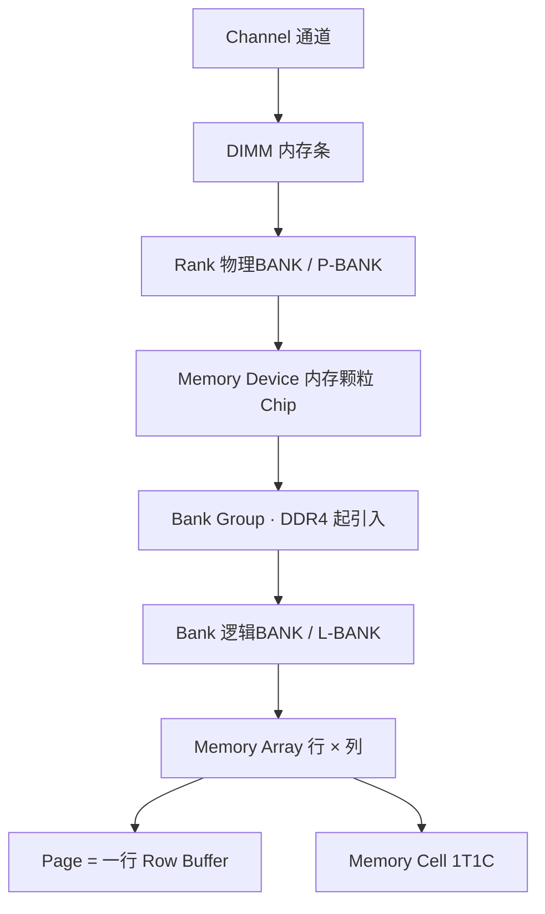

# PC上的DDR


图为PC机上的一块DDR内存条，其中框中的为一块DDR device也是一个内存颗粒。

# PC中的内存结构


上图为PC机中的内存结构，I/O控制器和内存控制器都分别分布在南桥和北桥，而在ARM的单片机中，Memory Controller和I/O Controller的等控制器是集成在CPU的SOC上的。

由于SRAM是静态不需要刷新而DRAM需要刷新，所以DRAM不像SRAM那样与CPU只是通过简单的数据线、控制线、地址线连接，而是CPU通过内存控制器进行一系列复杂的操作间接控制DRAM的，因为SRAM一般无需初始化直接使用，DRAM就需要进行初始化后才能使用。

# DRAM基本组成

## 1.组织结构

我们平时说的DDR颗粒也是一种芯片，也就是我们说的内存颗粒，而多个内存颗粒组成内存模组或者内存条，就是计算机里面使用的内存了。如果以内存颗粒，也就是chip（Memory device）为分界点，那么板级的概念是：Channel，DIMM， Rank。而Chip内部就是微观的概念是：Bank，Row，Column，Page，以及最小的Memory Cell。从大到小的组织层级如下：


从大到小的层级关系可用下图概括（Bank Group 为 DDR4 之后在 Bank 之上新增的一层，详见后文）：



## 2.Bit


对于DRAM，其主要由行和列组成，每一个bit中都是由类似右下图的类晶体管的结构组成，对于sdram的数据，可以通过控制column和row就可以访问sdram的随机地址的内容。读取某一个bit的状态，就是选中word line，那么图示中的晶体管M1就会导通，通过bit line的sense就可以感知到这个时候电容Cs上的状态，例如，现在如果这个bit的状态为1，那么导通之后就会从bit line上得到1，反之也是同样的道理。向某一bit写入1，首先通过row decoder选中word line,将会导致m1导通，那么bit line为1，会导致电容Cs充电，导致其电平为1，如果要写入，那么bit line的电平 为0，将会导致电容Cs放电，致使此时的电平为0。

## 3.Bank

由上一节可以看出一个位只能表示一个bit，那么我们想读取多个位的时候，该怎么办呢？那就出现了ddr中的bank的概念，由多个memory array就组成了一个bank，如下图，一次可以读取2bit/4bit/8bit的数据。


## 4.Memory device

由多个bank就可以组成一个memory device，如下图，一个dram的芯片，由8个banks组成，而每个bank由4个memory array构成，而此时每个bank输出4个bit的I/O bus，那么为什么会出现bank的概念呢？关键在于**同一个 bank 内切换行（row）的代价很高**：访问一个新行必须先 `PRE` 关闭当前行（`tRP`）、再 `ACT` 激活新行（`tRCD`），这段时间该 bank 无法响应读写，即受 `tRC = tRAS + tRP` 限制。如果只有 1 个 bank，连续访问不同行的地址就只能串行等待，总线大量空闲。

有了多个 bank 之后，不同的 bank 可以**独立地激活自己的行**：当我们访问 01 地址（bank0，rowA）时，可以让 bank1 提前 `ACT` 好 rowB，这样读完 01 后直接读 bank1 的 02 地址，把某个 bank 关闭/激活行的等待时间隐藏在其他 bank 的读写操作之后（即 bank 交错 interleave）。于是总线利用率大幅提高，同时刷新命令也可以在空闲间隙插入，从而"掩盖"掉动态内存必须刷新的开销。


## 5.Rank


- 定义
  Rank是DIMM中的一个独立的存储区域，可以独立地响应内存控制器的命令。一个DIMM可以包含一个或多个Rank。
- 组成
  一个Rank由多个内存芯片（Chips）组成，这些芯片并联在一起，共享同一组地址和控制信号。每个Rank需要提供64位的数据宽度，因此，使用x8规格的芯片时，一个Rank需要8个芯片。
- 为了和逻辑BANK相区分，也经常把RANK称为Physical BANK（物理BANK），简写为**P-BANK**。逻辑Bank，简写为**L-BANK**

## 6.DIMM

- 双列直插式内存模块（Dual in-line memory module），是最常见的内存模块类型之一。DIMM由多个内存芯片组成，安装在主板上的内存插槽中。
- DIMM的位宽是指每次数据传输的宽度，通常为64位（对于大多数服务器和台式机）。为了满足64位的数据传输要求，DIMM上的芯片数量和规格需要匹配。芯片规格有x4、x8和x16三种，分别提供4位、8位和16位的数据宽度，其中x16规格较少使用。为了达到64位的数据宽度，使用x4规格时需要16个芯片，使用x8规格时需要8个芯片，使用x16规格时需要4个芯片。DIMM可以是单面的（Single-Sided DIMM），所有芯片分布在DIMM的一侧，例如使用8个x8芯片；也可以是双面的（Double-Sided DIMM），芯片分布在DIMM的两侧，例如使用16个x4芯片，每侧8个。

# DRAM访问基础

## 1.1T1C 单元

- 每个 bit 由一个 NMOS 开关管（M1）和一个存储电容（Cs）构成，即 **1T1C** 结构，用电容上是否存有电荷表示 1 / 0。
- 读操作是**破坏性读取**
  选中 word line 使 M1 导通后，Cs 上的电荷会与 bit line 的寄生电容 Cb 电荷分享，读出动作本身就把原来的电荷量改变了。因此 sense amplifier 在判决出 1 / 0 之后，必须立刻把结果**重新写回**该 cell。
- 也正是这个读出即写回的动作，构成了后文**刷新（Refresh）**的物理基础——刷新的本质就是周期性地读出来、再写回去。

## 2.数据保持时间

- 电容并不理想，存在漏电流，电荷会缓慢流失，所以 DRAM 只能在有限时间内保持数据，这个时间称为**数据保持时间（Data Retention Time）**。
- 室温下 JEDEC 规定必须在 **64ms** 内把每个 row 完整刷新一遍；温度越高漏电越快，因此高温下需要提高刷新频率（见后文刷新机制）。

## 3.地址复用

- 一颗 8Gb 的颗粒如果行地址、列地址都单独引线，引脚数量无法接受。DRAM 的做法是**行地址与列地址共用同一组地址引脚 `A[0..n]`**，分两次送入：
	1. 先发 `ACT`（激活命令），此时 `RAS#` 有效，把**行地址**锁存进行锁存器，经 row decoder 选中对应 word line；
	2. 再发 `RD` / `WR`（读 / 写命令），此时 `CAS#` 有效，把**列地址**锁存进列锁存器，经 column decoder 选中对应 bit line，完成具体 cell 的读写。

- 这就是 `RAS`（Row Address Strobe，行地址选通）/ `CAS`（Column Address Strobe，列地址选通）名称的由来，也解释了为什么 DRAM 接口的引脚数可以远少于行数 × 列数所需。

## 4.差分信号

| 好处         | 说明                                                         |
| :----------- | :----------------------------------------------------------- |
| 判决门限稳定 | 判决只看两线之差，而不是与某个绝对电平比大小，门限不受 `VREF` 漂移影响 |
| 抗共模噪声   | 电源抖动、走线耦合等噪声同时叠加在两条线上，做差后被抵消     |
| 灵敏度高     | 可以分辨 `ΔV` 只有几十 mV 的微弱信号，cell 电容才能做得足够小 |
| 放大速度快   | 正反馈结构把微小 `ΔV` 迅速拉到全摆幅，缩短行访问时间 `tRCD`  |

## 5.预取与突发长度

### 1.频率与数据率

- DRAM 内部存储阵列（Memory Array）的工作频率受工艺与功耗限制，提升空间有限；而 I/O 接口电路可以跑得很快。
- 解决办法是**预取（Prefetch）**
  一次内部访问就把 `n` bit 数据从阵列搬到 I/O 缓冲，再由高速 I/O 以 `n` 倍速率串出，于是接口带宽可以成倍于核心频率。
- 记 I/O 时钟频率为 `f_IO`，则数据率与核心频率的关系大致为
  **数据率（MT/s）= 2 × f_IO = 2 × n × f_core**（`2` 来自 DDR 在上升沿和下降沿都采样）。

| 类型 | 预取 n | I/O 时钟（示例） |      数据率      | 核心频率 |
| :--: | :----: | :--------------: | :--------------: | :------: |
| SDR  |   1n   |      133MHz      | 133 MT/s（单沿） |  133MHz  |
| DDR  |   2n   |      200MHz      |     400 MT/s     |  100MHz  |
| DDR2 |   4n   |      400MHz      |     800 MT/s     |  100MHz  |
| DDR3 |   8n   |      800MHz      |    1600 MT/s     |  100MHz  |
| DDR4 |   8n   |     1600MHz      |    3200 MT/s     |  200MHz  |
| DDR5 |  16n   |     3200MHz      |    6400 MT/s     |  200MHz  |

> [!NOTE]
>
> 可以看到 DDR3 / DDR4 之后核心频率的涨幅远小于数据率，带宽的提升主要靠"一次搬更多 bit + I/O 跑更快"（预取 + 多 BG 交替）来实现。

### 2.突发长度 BL

- **突发长度**指一次 `READ` / `WRITE` 命令连续传输的数据个数，由 Mode Register 设定，常见 `BL4` / `BL8` / `BL16`。
- 预取位数决定了下限
  `8n` 预取意味着一次核心访问至少产生 8 拍数据，因此 DDR3/DDR4 的标准突发长度是 `BL8`。
- **突发截断 BC（Burst Chop）**
  半长突发，例如 `BC4` 表示按 BL8 寻址、但只传 4 拍后中止。
- DDR4 支持 `BL8 / BC4 on-the-fly`（由命令时的地址位 `A12` 动态选择），DDR5 则为 `BL16 / BC8`。

# DRAM发展过程

## 1.总体概览


RAS：Row Address Strobe 行地址选通/锁存控制线

CAS：Column Address Strobe 列地址选通/锁存控制线

## 2.Asynchronous DRAM

异步DRAM读写时序如下图所示：

## 3.FPM

Fast Page Mode，由于一般读内存具有局部性原理，即选中某一行，某一列读完后，一般还会接着读同一行的后续几列，这样行地址就只需要输入一次从而节省每次重新输入行地址的时间。


## 4.EDO

Extend Data-Out，就是在FPM的基础上，在输出数据的同时把地址给出，而不是等数据输出完才给地址，因为之前的地址已经被锁存锁住了，因此地址线上的地址可以即刻给出新地址。


## 5.BEDO

Burst EDO，爆发式的EDO，同样运用局部连续性原理，行地址保持不变，列地址不断通过内存寄存器+1，从而实现行列地址都只需要锁存一次大大节约时间。


## 6.SDR

同步的，让内存读写与CPU读写同步。


## 7.DDR

双倍速率的SDR，在上升沿和下降沿都进行数据采集。


## 8.DDR 代际演进

| 项目              |     DDR      |             DDR2              |           DDR3            |                 DDR4                 |                 DDR5                 |
| :---------------- | :----------: | :---------------------------: | :-----------------------: | :----------------------------------: | :----------------------------------: |
| 电压 VDD          |     2.5V     |             1.8V              |           1.5V            |                 1.2V                 |                 1.1V                 |
| 预取              |      2n      |              4n               |            8n             |                  8n                  |                 16n                  |
| 数据率            | 200–400 MT/s |         400–800 MT/s          |       800–1600 MT/s       |            1600–3200 MT/s            |            3200–6400 MT/s            |
| Bank / Bank Group |    4 Bank    |          4 / 8 Bank           |          8 Bank           |            4 BG × 4 Bank             |            8 BG × 4 Bank             |
| 突发长度          |  2 / 4 / 8   |             4 / 8             |         8（BC4）          |               8（BC4）               |              16（BC8）               |
| 命令 / 地址总线   |     公共     |             公共              |           公共            |                 公共                 |       拆分 CA（双通道子通道）        |
| 主要新特性        |   双沿采样   | ODT、Posted CAS、离线驱动校准 | DLL、ZQ 校准、Fly-by 拓扑 | Bank Group、DBI、CRC、字线上数据总线 | 片上 ECC、PMIC 供电、双 32bit 子通道 |

- **DDR**
  在 SDR 基础上改为上升沿 + 下降沿都采样，速率直接翻倍。
- **DDR2**
  引入 `ODT`（片上终端）与 `Posted CAS`（读命令可提前发出、由控制器内部延后，缩短 `tRCD` 的空等），并降低电压到 1.8V。
- **DDR3**
  在颗粒内部集成 `DLL` 对齐时钟/选通信号，引入 `ZQ` 校准与 **Fly-by** 拓扑（见后文信号与拓扑），电压降到 1.5V。
- **DDR4**
  在 Bank 之上新增 **Bank Group**，通过 BG 交错显著降低连续访问的间隔（见下节）；新增 `DBI`、`CRC`、`CA Parity` 等可靠性机制。
- **DDR5**
  预取翻倍到 16n，单条 DIMM 拆成两个独立的 32bit 子通道，引入**片上 ECC（On-Die ECC）**与板载 PMIC，电压降到 1.1V。

# DRAM读写步骤

## 1.读写过程四个阶段

了解了DDR的基本组成后，我们来看看DDR如何来完成一次的读写过程。如下图所示，DRAM 的相关操作在内部大概可以分为以下的四个阶段：

- **command transport and decode**
  在这个阶段，Host 端会通过 Command Bus （控制总线）和 Address Bus （地址总线）将具体的 Command 以及相应参数传递给 DRAM。
  DRAM 接收并解析 Command，接着驱动内部模块进行相应的操作。其中会根据将addr bus上的数据解码成对应的row address（地址线）和通过bank control解码后得到对应的bank，其次对应的column也会解码得到对应的地址。
- **in bank data movement**
  在这个阶段，第一阶段发送需要读取的 Column 的地址给 DRAM。然后 DRAM 再将 Active Command 所选中的 Row 中，DRAM 就将 Memory Array 中的数据从 DRAM Cells 中读出到 Sense Amplifiers，或者将数据从 Sense Amplifiers 写入到 DRAM Cells。
- **in device data movement**
  这个阶段中，数据将通过 IO 电路缓存到 Read Latchs 或者通过 IO 电路和 Write Drivers 更新到 Sense Amplifiers。
- **system data transport**
  在这个阶段，进行读数据操作时，SDRAM 会将数据输出到数据总线上，进行写数据操作时，则是 Host 端的 Controller 将数据输出到总线上。


在上述的四个阶段中，每个阶段都会有一定的耗时，例如数据从 DRAM Cells 搬运到 Read Latchs 的操作需要一定的时间，因此在一个具体的操作需要按照一定时序进行。同时，由于内部的一些部件可能会被多个操作使用，例如读数据和写数据都需要用到部分 IO 电路，因此多个不同的操作通常**不能同时进行**，也需要遵守一定的时序。此外，某些操作会消耗很大的电流，为了满足 SDRAM 设计上的功耗指标，可能会限制某一些操作的执行频率。

## 2.sense感知

### 1.预充电

由于bitline的电容一般比存数据的电容大，为了使bitline感知的灵敏度变高，一般预充电到VCC/2，如果读的是1，则bitline的电平被上拉到VCC，读的是0，则bitline电平由VCC/2被拉低到0。


### 2.差分位线

**每一个 memory cell 只接到一对位线中的一条**，这对位线就是

- `BL`（Bit Line，真）；
- `BL#`（Bit Line Bar，反，也常记作带上划线的 BL）。

二者一左一右接到同一个 **差分 sense amplifier（差分读出放大器）** 的两个输入端，构成一对差分线。关键在于**预充电阶段两条线都被充到同一个参考电平 `VREF`**（典型为 `VCC/2`）。此时 `BL` 与 `BL#` 电平相同，差分电压 `ΔV = 0`，sense amplifier 处在平衡的亚稳态。之所以让两条线都停在 `VCC/2`、而不是停在 `VCC` 或 `GND`，是为了让 word line 一打开，**无论读出的是 0 还是 1，两条线都能朝相反方向等幅摆动**，sense amplifier 两侧都获得最大且最快的响应。

### 3.差分放大过程

sensing 电路本来就是个平衡电路，由于选中后，导致某条线电压变化，导致不平衡，后续会慢慢区域平衡，导致两条差分线中有一条电压是VCC，有一条是GND。

1. **电荷分享（charge sharing）**
   word line 选中、M1 导通后，cell 电容 `Cs` 与位线寄生电容 `Cb` 发生电荷分享。若该 cell 存的是 1，`BL` 电平被略微抬高；存的是 0，`BL` 被略微拉低。而 `BL#` 不受任何影响，仍保持在 `VREF`。于是两条线之间产生一个**只有几十 mV 量级的微小差分电压 `ΔV`**（`Cs` 远小于 `Cb`，所以 `ΔV` 很微弱）。
2. **感测放大（sensing）**
   差分 sense amplifier 把这微弱的 `ΔV` 放大——`ΔV > 0` 时把 `BL` 拉满到 `VCC`、`BL#` 拉到 `GND`；`ΔV < 0` 时反过来。放大后两条线变成全摆幅的互补电平，判决完成。
3. **写回 / 恢复（restore）**
   放大后驱动到全摆幅的 `BL` 恰好把正确电平**重新写回 cell 电容**，补偿了电荷分享造成的损耗。这就是前面所说的破坏性读取必须写回，也正是刷新（Refresh）在电路上的动作。
4. **写操作**
   写时不由 cell 电荷分享，而是由 write driver 直接把 `BL` / `BL#` 驱动成互补的全摆幅电平，经导通的 M1 对 `Cs` 充电或放电，从而写入 0 或 1。

> [!NOTE]
> 差分的思路在后面会反复出现：`CK` / `CK#`、`DQS` / `DQS#` 都是差分信号；DDR4 之后 `DQ` 上的 `DBI`（Data Bus Inversion）也是同源思路——用取反来降低同时翻转的位数，从而减小噪声与功耗。

## 3.第二阶段步骤详解

### 1.读时序


### 2.写时序


## 4.时序参数

时延单位通常用 **tCK**（一个时钟周期）度量，例如 DDR4-3200 的 `tCK = 1 / 1600MHz = 0.625ns`。

|  参数   | 全称                 | 含义                                                         |   典型量级   | 存在意义                                                     |
| :-----: | :------------------- | :----------------------------------------------------------- | :----------: | ------------------------------------------------------------ |
| `tRCD`  | RAS-to-CAS Delay     | `ACT` 激活行之后，到可以发读写命令的最小间隔，即到可以打开列选择的间隔。<br /><br /><br />在发送列读写命令时必须与前面的bank激活命令（行有效也在其中）有一个间隔 |  13–18 tCK   | 这是根据芯片存储阵列内部响应时间所需要的延迟，这个和芯片的工艺相关，是必然存在的一个延时。 |
|  `tRP`  | Row Precharge        | 预充电所需时间（关闭当前行，为激活新行做准备）               |  13–18 tCK   |                                                              |
| `tRAS`  | RAS# Active Time     | 行激活后（Row Address Strobe（行地址选通））的最短保持时间，期间才能安全预充电 |  32–36 tCK   |                                                              |
|  `tRC`  | Row Cycle            | 同一 bank 内两次激活的最小间隔，`tRC = tRAS + tRP`           |  45–55 tCK   |                                                              |
|  `tCL`  | CAS Latency          | CAS （列读命令）发出之后，仍要经过一定的时间才能有数据输出，从CAS 读取命令发出到数据稳定输出（可以读取）的这段时间 |   9–22 tCK   | Delay（延迟）和Latency（潜伏）本质是不同的：Delay是事情要在这个时间之后开始，而Latency是事情已经发生，但是还不够稳定需要一个稳定时间。 |
| `tCWL`  | CAS Write Latency    | 写命令（列选通）发出到数据需要上到 DQ 的延迟                 |   9–16 tCK   |                                                              |
| `tRTP`  | Read-to-Precharge    | 读命令发出后，到可以预充电的最小间隔                         |   6–12 tCK   |                                                              |
|  `tWR`  | Write Recovery       | 最后一个数据写入后，到可以预充电的最小间隔                   |  10–18 tCK   |                                                              |
| `tWTR`  | Write to Read Delay  | 从一个写入命令发出到读取命令可以发出的最小时间间隔           |              | 该值表示的是，DDR 内存模块中的同一个单元中，在最后一次有效的写操作和下一次读操作之间必须等待的时钟周期。 |
| `tRRD`  | Row-to-Row Delay     | 不同 bank 之间连续两次激活的最小间隔                         |   4–8 tCK    |                                                              |
| `tFAW`  | Four Activate Window | 任意 4 次 `ACT` 必须落在此时间窗口内（限流用）               |  21–35 tCK   |                                                              |
| `tRFC`  | Refresh Cycle        | 一条刷新命令所占用的不可访问时长                             | 160–350 tCK  |                                                              |
| `tREFI` | Refresh Interval     | 相邻两次刷新的平均间隔                                       | 3.9 / 7.8 µs |                                                              |
| `tXSR`  | Exit Self Refresh | 从自刷新退出（`CKE` 拉高，即 SRX）到可以发下一条**不要求 DLL 锁定**的命令的最小间隔 | max(5 tCK, `tRFC` + 10ns) | 自刷新期间内部一直在自行刷新，退出后内部还要完成一次恢复，期间不接受任何命令 |
|  `tXP`  | Exit Power-Down | 从掉电退出（`CKE` 拉高，即 PDX）到可以发下一条有效命令的最小间隔 | DDR3: max(3 tCK, 6ns)<br />DDR4: max(4 tCK, 6ns) | 掉电时内部偏置与时钟停摆，退出后需要时间恢复稳定 |
| `tCKE`  | CKE Minimum Pulse Width | `CKE` 从低到高（或从高到低）必须保持的最小宽度 | DDR3: max(3 tCK, 5.625ns)<br />DDR4: max(3 tCK, 5ns) | `CKE` 脉冲太窄会被 DRAM 忽略，导致进入/退出低功耗模式失败 |
| `tMRD`  | Mode Register Set Command Delay | 一条 `MRS` 命令登记之后，到下一条命令（含下一条 `MRS`）的最小间隔 | 4 tCK（DDR3） | 模式寄存器写入需要时间生效，连写多个 MR 时必须逐条隔开 |

- **`tFAW` 为什么存在**
  连续激活多个 bank 会瞬间拉大电流，`tFAW` 用来限制单位时间内的激活次数，属功耗约束。一般一个有8个bank的device，最多只允许激活打开4个bank，不然太耗电了，这个4就是tFAW。
- **时序标注**
  内存条上常见的 `DDR4-3200 CL22-22-22`，三个数字依序是 `tCL - tRCD - tRP`。其中 `CL = 22 × 0.625ns = 13.75ns`，这就是厂商标注的 CAS 延迟。

- **`tXSR` / `tXP` / `tCKE` / `tMRD` 都属于"命令间隔"类参数**
  它们约束的不是数据什么时候到，而是**两条命令之间至少要隔多久**，是控制器调度器里必须遵守的硬约束。
- **容易混的变体**
  - `tXS` / `tXSDLL`：退出自刷新后要发**要求 DLL 锁定**的命令（如读），需额外等 `tDLLK`；
  - `tXPDLL`：从"预充电掉电 + DLL 冻结"恢复到要求 DLL 锁定的命令，取 max(10 tCK, 24ns)；
  - `tCKSRX` / `tCKESR`：进入 / 退出自刷新前后，`CK` 必须已经稳定若干拍。

## 5.延时参数

这几个缩写都在 Mode Register 里配置，描述的都是命令发出到数据出现之间到底要等多久。

|  缩写  | 全称                             | 含义                                                      |
| :----: | :------------------------------- | :-------------------------------------------------------- |
| `tBL`  | Burst Length                     | 突发长度，一次读/写命令连续传输的**拍数**（`BL8` = 8 拍） |
| `tCL`  | CAS Latency                      | 读命令发出到数据出现在 `DQ` 上的延迟，即 `tCL`            |
| `tCWL` | CAS Write Latency                | 写命令发出到数据需要上到 `DQ` 上的延迟，即 `tCWL`         |
| `tAL`  | Additive Latency to colum access | 加法延迟，`Posted CAS` 引入（DDR2 起），配置在 MR1        |
| `tRL`  | Read Latency                     | 控制器实际看到的读延迟：`RL = AL + CL`                    |
| `tWL`  | Write Latency                    | 控制器实际看到的写延迟：`WL = AL + CWL`                   |

- **`CL` 与 `RL` 的区别**
  `CL` 是颗粒内部固有的读延迟；`AL` 是控制器额外"加"进去的垫片。控制器排时序要用 `RL`，不是裸的 `CL`。当 `AL = 0` 时退化为 `RL = CL`。
- **`AL` 的用途**
  
  [对DDR2中总线时序（Post CAS技术中）附加延迟(AL)的理解_ddr post cas-CSDN博客](https://blog.csdn.net/qiancainiao/article/details/8617803)
  
  
  [对DDR2中总线时序（Post CAS技术中）附加延迟(AL)的理解 - mypostwww - 博客园](https://www.cnblogs.com/mypostwww/archive/2011/12/02/2272611.html)
  
  附加延遲(AL, additive latency)是使用Post CAS技术时，总线上发出CAS信号（读写/命令）后到这个指令实际被执行的延时。
- **现代实现**
  DDR4 / DDR5 的命令调度能力已经足够强，`AL` 基本置 0 不用，但寄存器字段仍然保留。
- **`BL` 与前几者的关系**
  `BL` 决定数据在 `DQ` 上持续几拍，`RL` / `WL` 决定数据从第几拍开始出现。"命令间隔 + 延迟 + 突发长度"三者共同决定总线上有没有空档。

命令到数据的链路（启用 posted CAS 时）：

```txt
ACT ──(AL)──> READ 命令 ──(CL)──> DQ 上出现数据 ──(BL 拍)──> 传输结束
```

- 从 **`READ` 命令**量起，到数据出现在 `DQ`：等 `CL`。
- 从 **`ACT`** 量起，到数据出现在 `DQ`：等 `AL + CL`，这个总延迟就是 `RL`。
- `AL = 0`（未启用 posted CAS）时，`ACT` 到 `READ` 之间需要满足 `tRCD`，此时 `RL = CL`。

## 6.第二阶段读写时序

### 1.SRAM


### 2.DDR


### 3.双倍速率实现原理

DDR上升沿和下降沿进行数据的操作，速率翻倍，但翻倍不是晶体管等元器件进行升级导致速度很快，而是改变输出数据的数量，如下图所示：

DDR只不过是时钟上升沿输出2\*N或者4\*N的数据，在下降沿在通过触发MUX多路选择器来把数据输出。见预取与突发长度一节的频率与数据率。

# DDR信号板级拓扑

## 1.信号分类

| 信号                    |     方向      | 作用                                                         |
| :---------------------- | :-----------: | :----------------------------------------------------------- |
| `CK` / `CK#`            | 控制器 → DRAM | 差分时钟，所有命令 / 地址在 `CK` 上升沿采样                  |
| `CKE`                   | 控制器 → DRAM | 时钟使能，拉低进入省电状态（含 Self Refresh）                |
| `CS#`                   | 控制器 → DRAM | 片选                                                         |
| `RAS#` / `CAS#` / `WE#` | 控制器 → DRAM | 命令编码                                                     |
| `A[0..n]`               | 控制器 → DRAM | 地址总线，行 / 列地址复用                                    |
| `BA` / `BG`             | 控制器 → DRAM | Bank Address / Bank Group 选择                               |
| `DQ`                    |     双向      | 数据总线，位宽即 x4 / x8 / x16                               |
| `DQS` / `DQS#`          |     双向      | 数据选通（Data Strobe），与 `DQ` 成对收发--一般相对于DQ的时钟延时1/4个周期再采集DQ上的数据，这个延迟就是控制器端的dll，注意与device端的DLL区分 |
| `DM` / `DBI`            | 控制器 → DRAM | 数据屏蔽（Data Mask）/ 数据总线反转（Data Bus Inversion）    |
| `ODT`                   | 控制器 → DRAM | 片上终端开关（On-Die Termination）                           |
| `ZQ`                    |       —       | 接 240Ω 精密电阻，供校准输出阻抗 / ODT 用                    |
| `VREF`                  |       —       | 参考电平，通常为 VDD / 2                                     |

## 2.源同步

- 即Source-Synchronous，其与早期的公共时钟不同，DDR 的 `DQ` 与 `DQS` 是**成对发送**的，发送方输出数据的同时输出 `DQS`，接收方用 `DQS` 去采样 `DQ`，这样时钟与数据的走线延迟可以相互抵消，频率得以做高。
- 因此 `DQS` 不是普通时钟，而是**数据选通**信号，读和写时分别由 DRAM 和控制器作为发送端。

## 3.布线 与分支

- **T 型分支（T-branch）**
  时钟 / 命令 / 地址走一条主干，再分出等长支路到每颗芯片（DDR2 及更早常用）。走线长、需严格等长。
- **Fly-by 拓扑**
  DDR3 起采用，时钟 / 命令 / 地址信号像菊花链一样依次串过每颗芯片。走线短、信号质量好，但代价是**每颗芯片收到的 `CK` 与它自己的 `DQS` 之间存在不同的偏斜（skew）**。
- 为解决这个偏斜，必须在初始化时做**训练（Training）**
  - **Write Leveling**
    DRAM 回采样 `DQS` 与 `CK` 的相位差，控制器据此为每颗芯片调整 `DQS` 的发射延迟；
  - **Read Gate Training**
    确定读数据时的选通有效窗口位置；
  - **CA Training**
  - 校准命令 / 地址的采样点。

## 4.校准

- **ODT（On-Die Termination）**
  把终端电阻做进芯片内部，按读写方向动态开关，抑制信号反射。空闲的 rank 关闭 ODT、被访问的 rank 打开 ODT。
- **DLL（Delay-Locked Loop）**
  DDR3 起集成在颗粒内部，用来自动对齐内部时钟与外部 `CK` / `DQS` 的相位，抵消 PVT（工艺 / 电压 / 温度）漂移。
- **ZQ 校准**
  芯片的 `ZQ` 引脚外接一只 240Ω 精密电阻作为基准，通过 `ZQCL`（上电长校准）/ `ZQCS`（周期性短校准）命令校准输出驱动阻抗与 ODT 阻值，保证不同芯片、不同温度下阻抗一致。

> [!NOTE]
>
> 上述训练与校准在真实移植中的具体流程（JEDEC 上电序列、寄存器配置、DDR 控制器参数）属于**驱动实操**，参见 `08_Linux系统移植与驱动开发\02_U-Boot基础.md` 中的「DDR初始化流程」一节，本篇只做概念铺垫

# DRAM刷新机制

## 1.刷新的意义

- 1T1C 单元的电容会漏电，电荷流失后数据即出错，因此必须在数据保持时间内把每一行读出来、再写回去。
- JEDEC 规定室温下 **64ms** 内要把所有 row 刷新一遍。
- 以 8192 行（`8K refresh`）为例，平均刷新间隔 `tREFI = 64ms / 8192 ≈ 7.8µs`；若实现为 `4K refresh`，则 `tREFI ≈ 3.9µs`。
- 温度升高（≥85℃）漏电加剧，需要**翻倍刷新**（`tREFI / 2`），即常说的2x refresh。

## 2.两种刷新方式

| 方式               | 触发                        | 特点                                                 | 应用场景                 |
| :----------------- | :-------------------------- | :--------------------------------------------------- | :----------------------- |
| Auto Refresh（AR） | 控制器周期性下发 `REF` 命令 | 占用 `tRFC` 期间整个颗粒不可访问，需要控制器排队调度 | 正常工作时               |
| Self Refresh（SR） | 拉低 `CKE`、停止 `CK`       | DRAM 用内部振荡器自行刷新，功耗极低但带宽为零        | 待机 / 挂起 / 低功耗休眠 |

- **刷新开销**
  `tRFC / tREFI` 大致就是刷新占用的带宽比例。以 DDR4-3200（`tRFC ≈ 350ns`，`tREFI = 7.8µs`）估算，约 **4–5%** 的带宽用于刷新，这也是刷新会明显影响实测带宽的原因。
  
- **注意区别**

  预充电precharge是把bit line电压都维持到VCC/2，而刷新是对1T1C的电容进行充电，与读的步骤相比仅仅只是少了一个列选通。
  刷新完后，还需要进行预充电把bit line恢复为VCC/2。

- **常见误解澄清**
  刷新是**按行（row）**进行、面向整颗 chip 的，由控制器统一调度；并**不是**某个 bank 自己在后台完成自刷新。多 bank 的作用是让控制器可以把刷新命令插到其他 bank 的操作间隙里，从而把刷新开销"藏"起来，而不是让 bank 各刷各的。

# DDR操作状态机

对于一款ddr，我们需要知道通过什么样的方式来控制完成我们需要，我们来看看ddr的状态，ddr的工作就是在这几个状态之间切换


在芯片上电后，完成初始化后，dram处于idle阶段。上图是需要进入各个阶段的时候，应该需要进行那些基本的操作，对于ddr使用比较频繁的几个基本命令访问方式如下

- **刷新模式**
  储体中电容的数据有效是有时间限制的，所以为了保证数据的不丢失，所以要对ddr进行定时的刷新，SDRAM内部有一个行地址生成器（也称刷新计数器）用来自动的依次生成行地址。由于刷新是针对一行中的所有存储体进行。该模式是由Host主动控制DRAM完成刷新，存储体中电容的数据有效保存期上限是64ms（毫秒，1/1000秒），也就是说每一行刷新的循环周期是64ms。
- **自我刷新模式**
  当系统进入低功耗模式，只需要发送一条 SRF指令，主要用于休眠模式低功耗状态下的数据保存，比较常见的应用是STR（Suspend to RAM，休眠挂起于内存）。就进入了该模式，此时不再依靠系统时钟工作，而是根据内部的时钟进行刷新操作。期间除了CKE之外的所有外部信号都是无效的（无需外部提供刷新指令），只有重新使CKE有效才能退出自刷新模式并进入正常操作状态
- **MRS模式(mode register set)**
  模式寄存器中的数据控制着 DDR2 SDRAM的操作模式。它控制着 CAS 延迟, 突发长度, 突发顺序, 测试模式, DLL复位, WR等各种选项，支持着 DDR2 SDRAM 的各种应用。模式寄存器的默认值没有被定义, 所以上电之后必须按规定的时序规范来设定模式寄存器的值。
- **EMRS 扩展模式寄存器**
  存储着激活或禁止DLL的控制信息, 输出驱动强度, ODT 值的选择 和附加延迟等信息
- **预充电**
  对一行读写操作后，关闭现有工作行，准备打开新行的操作就是预充电。
- **读过程**
  访问操作开始ACT一个激活命令，主要是激活bank和rol，就等于选通了某一Bank的某一行，接着发送一个read指令，就可以通过数据总线将数据送出去了，然后就进行预充电，恢复到读写的状态，预充电完成后，就恢复到idle状态。
- **写过程**
  与读过程基本类似。

DRAM的基本命令是通过操作各种控制信号/地址信号的组合来完成，下表是DRAM的命令表

# DDR上电初始化

## 1.模式寄存器

颗粒内部有一组模式寄存器，控制器通过 `MRS` 命令把工作参数写进去（DDR4 用 `A[17:16]` 选择 `MR0~MR6`）。常见字段如下：

|   寄存器    | 主要字段                           | 作用                              |
| :---------: | :--------------------------------- | :-------------------------------- |
|    `MR0`    | 突发长度 BL、CAS 延迟 CL、DLL 复位 | 最基本的读写参数                  |
|    `MR1`    | DLL 使能、输出驱动强度、`Rtt_Nom`  | 驱动与终端配置                    |
|    `MR2`    | `tCWL`、`Rtt_WR`                   | 写延迟与写终端                    |
|    `MR3`    | MPR（多用途寄存器）、训练模式      | 供 Write Leveling / Read 训练使用 |
| `MR4`–`MR6` | 各类训练与刷新相关选项             | 代际间有差异                      |

- 记住一点即可：**数据手册里可配置的东西，绝大部分最终都落在这几个寄存器里**，由内存控制器在上电时一次性写入。

## 2.上电初始化

DDR 上电后不能立刻读写，JEDEC 规定了一套上电序列：

1. 上电，`CKE` 保持拉低，稳定时钟输入；
2. 等待上电稳定时间 `tINIT`，期间 `ODT` 保持高阻；
3. 发送 `PRE`，**预充电所有 bank**；
4. 写 `MR2 → MR3 → MR1 → MR0`（顺序有讲究，例如先配置 ODT / DLL，最后写 MR0 并触发 DLL 复位）；
5. （DDR3 及以后）执行 `ZQCL` 做长校准；
6. 等待 `tDLLK` / `tZQinit` 等时间后，拉高 `CKE`，进入正常操作。

# DDR的读写时序

## 1.read cycle


### 1.突发读


### 2.突发读后写


WL = RL - 1是DDR芯片手册规定的，固定的。

### 3.无缝突发读


## 2.wirte cycle


### 1.突发写


### 2.突发写后读


### 3.无缝突发写


## 3.precharge


## 4.refresh cycle


图为一次刷新刷两行。所以tRFC = 2 \*tRC


# DDR的DLL

## 1.控制器的DLL

## 2.Device的DLL

## 3.DQS Cleaning

**是什么**

读操作时把 DRAM 送回来的 `DQS` 选通信号"净化"——只保留与有效数据窗口重合的跳变，屏蔽掉三态区、preamble 之前与 postamble 之后产生的**伪边沿（毛刺）**。不是 JEDEC 术语，是控制器 / PHY 读通路里的工程叫法，专利里就有直接命名为 `clean_DQS` 的信号。

**为什么需要**

一次读突发的 `DQS` 分三段：preamble（拉低的静止期）→ burst（随 `DQ` 正常翻转）→ postamble（拉低的静止期），随后回到 **High-Z**。

- `DQS` 在 低电平 ↔ High-Z 转换时，受传输通道寄生电感电容影响会**产生毛刺**；
- 三态期间输入端可能停在中点电位，被耦合噪声打出伪脉冲。

这些伪边沿一旦被当作选通去采样 `DQ`，直接读错数据。

> [!NOTE]
> `DLL` 只负责把时钟 / 选通的**相位**对齐，管不了三态期的毛刺；`DQS Cleaning` 是 PHY 前端拿到 `DQS` 之后做的整形 / 门控，两者配合使用。

**四种做法**

| 机制 | 做法 |
| :--- | :--- |
| 门控（gate / window） | 产生 `DQS_en` / `DQS_GATE` 使能窗，与 `DQS` 相与。窗口上升沿落在 preamble 中央，靠**边沿计数器**数够预期跳变数后自动关闭（self-close），支持连续读 |
| Hi-Z 屏蔽 / 掩码 | preamble 检测电路生成 mask 释放信号，把有效窗口外的边沿（含毛刺）掩掉 |
| 钳位 + postamble 电路 | 读期间把 `DQS` 钳到 GND（反相的 `BDQS` 钳到 VDD），不让它悬空；postamble 期把驱动 `DQ` 寄存器的移位 `DQS` 接地 |
| 输入缓冲失调 | 给差分接收器加静态 DC offset + 动态 offset，三态 / 噪声不再翻转输出，无需门信号、无需训练，即 "self-DQS cleaning" |

**净化之后**

`clean_DQS` 移相约 90° 摆到数据眼中央，去时钟 `DQ` 捕获（FPGA 里是 ISERDES）与 FIFO 写指针；同时统计它数到的边沿个数，**数不够就报 burst error**。

**与相邻概念区分**

| 概念 | 解决的问题 | 手段 |
| :--- | :--- | :--- |
| DQS Cleaning | 毛刺 / 伪边沿 | 门控、掩码、钳位、输入失调 |
| Read Leveling / DQS Centering | `DQS` 没对准数据窗 | 调 IDELAY / PHASER 的 tap 位置 |
| Write Leveling | 写方向 `DQS` 与 `CK` 的偏斜 | 逐颗芯片调 `DQS` 发射延迟 |
| DLL | 相位漂移 / PVT 变化 | 延迟锁相环 |


# 参考链接

[深入浅出DDR系列(一)--DDR原理篇【转】 - Sky&Zhang - 博客园](https://www.cnblogs.com/sky-heaven/p/15929817.html)
[深入浅出DDR系列(二)--DDR工作原理【转】 - Sky&Zhang - 博客园](https://www.cnblogs.com/sky-heaven/p/15929821.html)
[DDR4 SDRAM - 理解时序参数 - miyan - 博客园](https://www.cnblogs.com/xyjk1002-rejuvenation/p/16477838.html)
[深入理解 DDR：DDR 的时序参数 - 极术社区 - 连接开发者与智能计算生态](https://community.aijishu.com/a/1060000000505280)

DQS Cleaning 相关：

- [US20090161452A1 - Systems and methods for clean DQS signal generation in source-synchronous DDR2 interface design](https://patents.google.com/patent/US20090161452A1/en)
- [US10147481B2 - Clean data strobe signal generating circuit in read interface device](https://patents.google.com/patent/US10147481B2/en)
- [US20180082725A1 - Strobe Acquisition and Tracking](https://patents.google.com/patent/US20180082725A1/en)
- [US12087392 - Memory interface device（DC / 动态 offset，self-DQS cleaning）](https://patents.google.com/patent/US12087392)
- [Intel - DQS Postamble Circuitry](https://www.intel.com/content/www/us/en/docs/programmable/683665/current/dqs-postamble-circuitry.html)
- [Intel - Strobe Enable Window Calibration](https://www.intel.com/content/www/us/en/docs/programmable/683716/23-4/strobe-enable-window-calibration-31485.html)
- [Xilinx XAPP858 - DQS Postamble Glitch Gating Circuit](http://www.bdtic.com/download/XILINX/xapp858.pdf)
