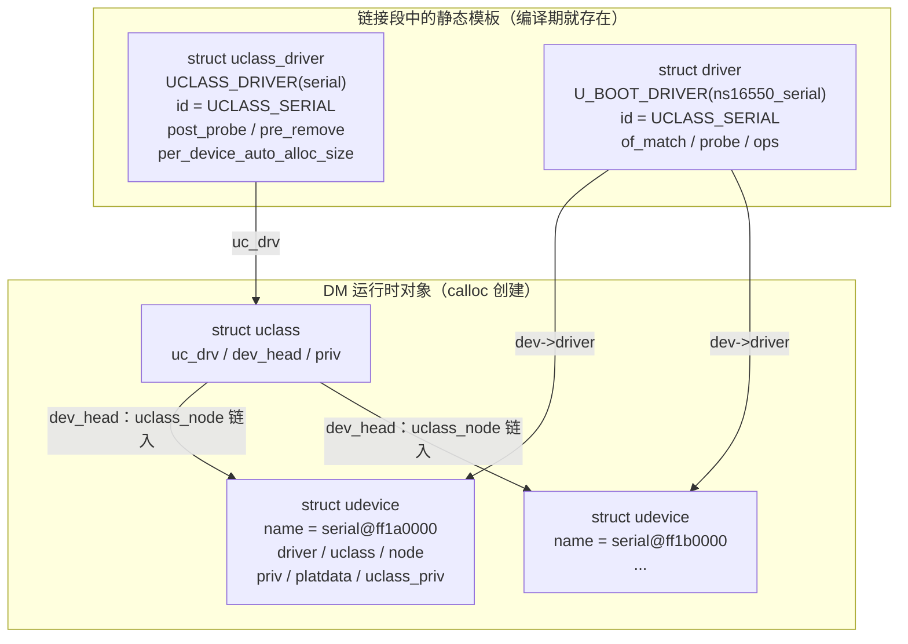
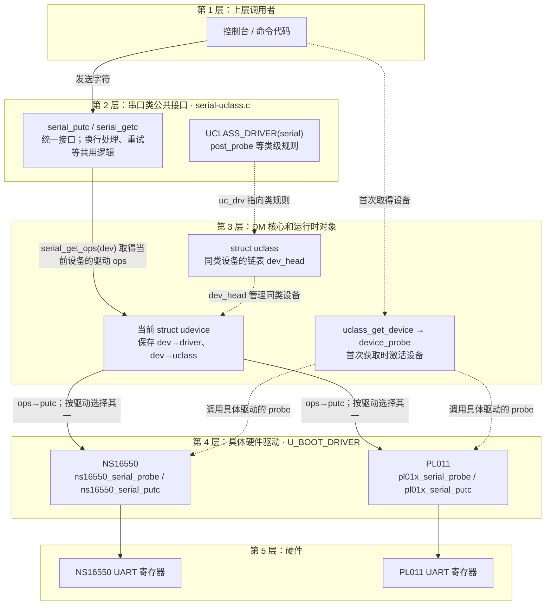

# 背景介绍

U-Boot难看懂流程除了代码量大，还一个重要的原因就是有些术语概念不理解，导致看不懂代码，因此本笔记主要就是介绍一些本人对U-Boot代码分析时遇到的一些概念术语的理解。

# ——安全启动相关——

[ATF引导启动流程整理-Part1：简介部分 - silas12138 - 博客园](https://www.cnblogs.com/silas041301/p/18679630)
[ATF引导启动流程整理-Part2：BL1引导启动流程整理 - silas12138 - 博客园](https://www.cnblogs.com/silas041301/p/18679660)
[ATF引导启动流程整理-Part3：BL2引导启动流程整理 - silas12138 - 博客园](https://www.cnblogs.com/silas041301/p/18679684)
[安全启动 - 一只Tom的笔记本](https://tomsjtu.github.io/notes/arm/secure_boot/#bl1)
[ATF入门-4BL31启动流程分析 - 知乎](https://zhuanlan.zhihu.com/p/2025983597237028579)

# UBoot安全启动

## 1.安全引导

安全引导（Secure Boot）功能是指在系统的整个启动过程中，使用**链式**验证电子签名的方式来验证系统中重要镜像文件的可靠性，然后再加载镜像文件的引导过程。

安全引导功能可以保护二级厂商系统的独立性和完整性。安全引导功能的原理就是采用链式验签的方式启动系统，也就是在系统启动过程中，在加载下一个阶段的镜像之前都会对需要被加载的镜像文件进行电子验签，只有验签操作通过后，该镜像才能被加载到内存中，然后系统才会跳转到下一个阶段继续执行，整个验签链中的任何一环验签失败都会导致系统挂死，系统启动过程中的第一级验签操作是由Chip ROM来完成的。

## 2.安全启动原理

只要芯片一出厂，用户就无法修改固化在芯片中的这部分代码，因此无法通过修改第一级验签结果来关闭安全引导功能。而且验签操作使用的RSA公钥或者哈希值将会被保存在OTP（**一次性可编程存储器**）/efuse（**电子熔丝**）中，该区域中的数据一般只有Chip ROM和TEE能够读取且无法被修改。RSA公钥或者哈希值将会在产品出厂之前被写入到OTP/efuse中，而且不同厂商使用的密钥会不一样。

## 3.镜像验签流程


# ARM Trust Zone

## 1.基本概念

Trust Zone 是 ARM 为设备安全开发的一个**硬件架构**。它通过**硬件隔离的方式**将系统分为了两个环境——Non Secure 和 Secure ，也叫做 Normal 和 Trusted。

使用 TrustZone，在同一颗芯片里的 CPU、内存和外设，就可以按安全和非安全两种访问身份来管理。普通软件即使知道某个安全区域的地址，也不能直接访问它。这种架构类似于设置了一道由硬件检查的门：

```
普通系统（Non-secure）：Linux、普通应用
安全环境（Secure）：安全固件、可信执行环境中的程序
CPU 发起读写 → 总线携带 Secure/Non-secure 身份
             → 硬件检查目标地址是否允许访问
```

硬件隔离实现在两个方面：
- **外设隔离**
  例如把某个 UART 配成安全外设。普通系统即使知道它的寄存器地址，访问也会被硬件拦住；安全环境可以操作它。
- **内存隔离**
  例如从 DDR 中划出一段给安全环境存放密钥。`TZASC` 这类硬件负责检查对这段地址的访问。普通系统可以使用 DDR 的其他区域，却不能读写这段安全区域。

这里的把 UART、DDR 分成两个部分容易引起误解：不是把一颗 UART 物理切成两半，也不是必须把整块 DDR 对半分。通常是配置哪些外设或哪些内存地址范围属于安全区域。

例如：

Linux 需要加密服务，但密钥放在安全内存中。Linux 可以提出请用密钥加密这段数据的请求，由安全环境完成操作并返回结果；Linux 自己不能直接读取密钥。TrustZone 提供的就是这种隔离所需的硬件基础。

## 2.TZASC

TZASC是 **TrustZone Address Space Controller**，可以把它理解为 DDR 访问的硬件门卫。例如，芯片把 DDR 的一段地址配置为安全区域，用来放密钥：

```shell
DDR 地址范围
├─ 0x00000000～0x0FFFFFFF：普通区域
└─ 0x10000000～0x10FFFFFF：安全区域
```

CPU 或其他总线设备访问 DDR 时，请求会带有 **Secure 或 Non-secure** 身份。TZASC 检查访问的地址和请求的身份：Non-secure 请求若访问安全区域，就会被硬件拦住；Secure 请求则可按配置访问。

TZASC 通常是 **SoC（芯片）内部的独立硬件模块**，属于内存访问通路的一部分，**不是 CPU 核心内部的部件，也不是 UART 那样供软件收发数据的外设**。可以这样理解它的位置：

```
CPU / DMA → 芯片内部总线 → TZASC 权限检查 → DDR 控制器 → DDR
```

CPU 或 DMA 发起读写时，请求带着 Secure / Non-secure 身份；TZASC 根据目标 DDR 地址和预先配置的规则，决定是否放行。具体芯片中它也可能与 DDR 控制器或总线安全模块集成，位置要以该芯片的硬件手册为准。

# TEE 可信执行环境

## 1.基本概念

TEE（Trusted Execution Environment，可信执行环境）是 CPU 内部一块与普通系统隔离的安全运行环境，由 ARM 的 **TrustZone** 技术实现。TrustZone 把 CPU 切分成两个相互隔离的世界：

- **Normal World（普通世界）**
  跑 Linux、U-Boot 等普通系统，看不到安全世界的数据。
- **Secure World（安全世界）**
  跑 TEE OS，一个隔离的安全小系统。

TEE 里跑的是敏感业务：DRM 密钥、指纹识别、支付、密钥存储、安全启动校验等。Linux 想用这些功能时，通过 `SMC`（Secure Monitor Call）指令请求服务，只能拿到结果，拿不到底层敏感数据（见TZASC举例）。

## 2.TEE定位

以瑞芯微（Rockchip）为例，完整启动链：

```txt
BootROM → TPL/SPL(idbloader.img) → U-Boot → trust.img → Linux Kernel
```

`trust.img` 是 **BL31 + OP-TEE** 打包而成：

| 组成                                  | 说明                                                         |
| ------------------------------------- | ------------------------------------------------------------ |
| **BL31**（ATF，ARM Trusted Firmware） | 跑在 EL3 最高特权级，做安全初始化，管理两个世界的切换        |
| **OP-TEE**                            | TEE OS 本体，跑在 Secure World（S-EL1），给 Linux 提供安全服务 |

## 3.TEE作用

ARM Cortex-A 系列按异常级别逐级启动：**EL3 → EL2 → EL1**，权限逐级下降：

1. BootROM / SPL 运行在 EL3，权限最高。
2. 要跳转到 Linux（EL1）之前，必须先布置好安全世界（EL3 / S-EL1）。
3. BL31 负责从 EL3 下放权限、建立 Secure World、装载好 TEE OS，最后才跳转到 Linux。

所以没有 BL31 / trust.img，ARM 芯片（尤其 Rockchip、全志、i.MX8 这类）起不来 Linux。

## 4.SPL 与 BLx 的关系

SPL 与 BLx 分属两套命名体系，描述的是同一启动过程：

- **SPL / TPL** 是 U-Boot 项目的术语（Secondary / Tiny Program Loader）；
- **BLx** 是 ARM ATF（Trusted Firmware-A）及部分厂商（如三星 Exynos）的术语（Boot Loader + 阶段编号）。

角色大致对应：**SPL ≈ BL2**（都负责 DDR 初始化与镜像加载），**BL1 ≈ BootROM**（芯片固化代码）。以 i.MX8 为例：

```txt
BootROM(BL1) → SPL(BL2) → ATF BL31 → OP-TEE BL32 → U-Boot(BL33) → Linux
```

但需注意，不同厂商对 BL1 / BL2 的分工并不统一
三星 Exynos 的 BL0 为 iROM（BootROM），BL1、BL2 分两段，到 BL2 才做 DDR 初始化；部分平台因 SRAM 过小，采用 TPL → SPL → U-Boot 三段式。因此SPL 就是 BL2对多数 ARM 平台成立，但遇到具体 SoC 应先确认其 BL1 / BL2 各自负责到哪一步。

## 5.启动流程


# ARM Trusted Firmware

## 1.引入背景

在Armv8中，TF(Trusted Firmware)是ARM引入的**安全解决方案**，它的核心功能为对启动和运行过程进行特权级划分，为安全提供了整体解决方案。

相较于Armv7中的Trust Zone（TZ）进行了提高，它包括启动和运行过程中的特权级划分，**实现了启动过程信任链的传导，细化了运行过程的特权级区间**。

TF实际有两种Profile，对ARM Profile A的CPU应用TF-A，对ARM Profile M的CPU应用TF-M。我们一般接触的都是TF-A，又因为这个概念是ARM提出的，有时候也缩写做ATF（ARM Trusted Firmware）。

## 2.异常级别

EL = **Exception Level**（异常级别）。CPU 上电启动或遇异常/中断时，会在不同特权层切换，这些层就叫异常级别。ARM64 分 4 层，数字越大权限越高：

```txt
EL0  应用程序层   ← Linux 用户程序跑这
EL1  内核层       ← Linux 内核跑这
EL2  Hypervisor   ← 虚拟机管理层，没虚拟化就跳过
EL3  最高层       ← 安全监控，ATF/BL31 跑这，管 Secure/Normal 切换
```

启动顺序：**EL3（上电）→ 往下掉到 EL1 → EL0**。每层能管下面，下面碰不到上面。

再加两个维度：

- Secure World 里 EL1 = **S-EL1**，跑 TEE OS（OP-TEE）。
- Normal World 里 EL1 = **NS-EL1**，跑 Linux。


## 3.ATF 固件代号

ARM Trusted Firmware（ATF）把启动分成几个阶段，按 **BL（Boot Loader）+ 数字**命名


```txt
BL1  第一阶段引导    最底层，上电先跑
BL2  第二阶段引导    加载后面的镜像
BL31  EL3 运行时固件 Secure Monitor，常驻 EL3，管世界切换bl31包含两部分功能，
	 在启动时作为启动流程的一部分，执行软硬件初始化以及启动bl32和bl33镜像。
     在系统启动完成后，将继续驻留于系统中作为runtime，并处理来自其它异常等级的smc异常，以及其它需要路由到EL3处理的中断等。
BL32  Secure World 固件 = TEE OS（OP-TEE）
BL33  Normal World 固件 = U-Boot / EDK2

BL31、BL32和BL33都是由BL2加载的，其中BL31和BL32是可选的，若系统不支持TRUST OS，则可去掉BL32，若不支持EL3异常等级及secure monitor，则可去掉BL31
```

| ATF 代号 | 对应 Rockchip                       |
| -------- | ----------------------------------- |
| BL1      | BootROM（芯片内置）                 |
| BL2      | TPL/SPL（idbloader.img）            |
| BL31     | ATF，在 trust.img 里                |
| BL32     | OP-TEE（TEE OS），也在 trust.img 里 |
| BL33     | U-Boot                              |

# 不同ARM架构安全策略

## 1.ARMv7

ARMv7 有 EL 概念但没有 EL3（沿用 old-style 特权模式），也没有 ATF 标准。可信执行环境就是 TOS（Trusted OS = OP-TEE） 本身。所以在`RockChip`的uboot编译脚本里可以看到：

```shell
  if [ "${ARM64_TRUSTZONE}" == "y" ]; then
      ${SCRIPT_ATF} --ini ${INI_TRUST} ...   # ARM64：ATF，产出 bl31 → trust.img，bl31 = Boot Loader 阶段 3 的第 1 个组件，正好是常驻 EL3 的安全监控固件
  else
      ${SCRIPT_TOS} --ini ${INI_TRUST} ...   # ARM32：直接打包 TOS → trust.img，ARM32 没 EL3/ATF，安全固件直接是 TOS。
  fi
```

## 2.ARMv8

 ARMv8-A 是架构名，它定义两种执行状态：

  - AArch64 —— 64 位
  - AArch32 —— 32 位

同一个 ARMv8 核，可以跑 AArch64，也可以跑 AArch32（向后兼容 ARMv7 指令）。所以 ARM32 完全可以是 ARMv8——只是它跑在AArch32 状态。

|     情况     |     核     | trust镜像 |
| :----------: | :--------: | :-------: |
|   纯 ARMv7   | 只有 32 位 |    TOS    |
| ARMv8 + 64位 |  AArch64   |    ATF    |
| ARMv8 + 32位 |  AArch32   |    ATF    |

 关键：ARMv8 核有 EL3 / TrustZone，AArch64、AArch32 状态都有。ARMv7 核没有 EL3。

## 3.异同总结

两种架构的安全启动都遵循下列流程：

```bash
BootROM → loader(带DDR init) → trust.img → uboot → kernel

#loader 把 trust.img 搬进安全内存，再跳 U-Boot。U-Boot 要干安全相关的活（开副核、复位、进 TEE）就发 SMC指令陷进安全世界，由 trust 那块处理。
```

 两者差别在「安全世界」：

  ARMv8：trust.img = 安全监控器本身（EL3）

  - 内容 = bl31（ATF 的 EL3 Runtime），可选再拼 bl32（OP-TEE）

  - 跑在 EL3，就是常驻的 secure monitor

  - 职责
     世界切换（secure↔non-secure，靠 SMC）、PSCI（CPU 开/关/复位/电源）都在这里、EL3 异常处理

  - OP-TEE 是独立的 bl32，跑 Secure-EL1，负责可信 OS 服务（TEE 调用）

  - 打不打包进同一个 trust.img 看配置

    ```bash
      EL3   bl31   #← trust.img 主体，常驻
      EL1S  bl32(OP-TEE)  #← 可选，也常进 trust.img
      EL1NS bl33   #= U-Boot
    ```

  ARMv7：trust.img = 安全 OS（TOS / OP-TEE）

  - 内容 = TOS（Trusted OS，即 OP-TEE），没有 bl31

  - ARMv7 没 EL3 概念。安全世界用 TrustZone 的 monitor mode 管切换，OP-TEE 自己兼任

  - 职责
    跑到 secure 侧当可信 OS、处理 TEE 调用，PSCI 也由它提供（或内嵌 PSCI stub）

    ```bash
      Mon   OP-TEE(TOS)  #← trust.img，兼做 monitor
      EL1NS  #U-Boot
    ```

# ——驱动模型——

# U-Boot DM

## 1.基本概念

DM (Driver Model) 是 U-Boot 标准的 device-driver 开发模型，跟 kernel 的 device-driver 模型非常类似。整个DM框架的三个核心对象如下：

| 对象      | 含义                                                         | 例子                           |
| --------- | ------------------------------------------------------------ | ------------------------------ |
| `uclass`  | 运行时管理同类设备的对象，保存类规则指针和设备链表           | enum uclass_id；id与类一一对应 |
| `driver`  | 包含设备树匹配表，所属的uclass id、probe 和硬件操作ops，由`U_BOOT_DRIVER()` 定义为全局驱动记录 | `led_gpio`                     |
| `udevice` | 一台具体设备的运行时实例，记录其驱动、uclass、父设备、设备树节点等 | RK3506 的 `uart0`              |

## 2.结构体源码分析

| 结构体                 | 本质                     | 数量                        | 存放位置                |
| ---------------------- | ------------------------ | --------------------------- | ----------------------- |
| `struct driver`        | 驱动的静态代码/模板      | 每个 `U_BOOT_DRIVER()` 一个 | 链接段中，只读静态数据  |
| `struct uclass_driver` | 设备类的静态规则         | 每个 `UCLASS_DRIVER()` 一个 | 链接段中，只读静态数据  |
| `struct uclass`        | 一类设备的运行时分组容器 | 每个 `uclass_id` 一个       | DM 运行时 `calloc` 分配 |
| `struct udevice`       | 一台具体设备的运行时实例 | 每个设备实例一个            | `bind` 时 `calloc` 分配 |

```c
driver/uclass_driver是编译期模板，uclass/udevice是运行期对象。
```

### 1.设备实例

源码：`include/dm/device.h`

```c
struct udevice {
    const struct driver *driver;   /* 指向静态驱动模板 */
    const char *name;              /* 设备名，通常是设备树节点名 */
    void *platdata;                /* 本设备的配置数据 */
    void *parent_platdata;         /* 父总线给本设备保存的配置数据 */
    void *uclass_platdata;         /* uclass 给本设备保存的配置数据 */
    ofnode node;                   /* 对应的设备树节点 */
    ulong driver_data;             /* of_match 匹配到的 data */
    struct udevice *parent;        /* 父设备，根设备为 NULL */
    void *priv;                    /* 驱动私有数据 */
    struct uclass *uclass;         /* 所属的 uclass */
    void *uclass_priv;             /* uclass 给本设备保存的私有数据 */
    void *parent_priv;             /* 父设备给本设备保存的私有数据 */
    struct list_head uclass_node;  /* 挂入 uclass->dev_head */
    struct list_head child_head;   /* 本设备的孩子链表头 */
    struct list_head sibling_node; /* 挂入 parent->child_head */
    uint32_t flags;                /* DM_FLAG_... */
    int req_seq;                   /* alias 请求的序号，-1 表示任意 */
    int seq;                       /* probe 时解析出的唯一序号 */
#ifdef CONFIG_DEVRES
    struct list_head devres_head;  /* devm_* 分配的资源链表 */
#endif
};
```

`udevice` 同时身处**两套组织关系**中：

1. **父子树**
   `parent` + `child_head` + `sibling_node`，描述设备树上的层级，比如 `i2c0` 下面挂着 `pmic`。
2. **同类链表**
   `uclass` + `uclass_node`，把同一类设备串进 `uclass->dev_head`，比如所有串口都在 `UCLASS_SERIAL` 下面。

此外 `dev->driver->ops` 决定这台设备具体怎么操作硬件，`dev->uclass` 决定这台设备归哪一类统一管理。`udevice` 里有六个 `void *` 数据指针区分如下：

| 指针              | 分配依据                                                     | 拥有者/使用者  |
| ----------------- | ------------------------------------------------------------ | -------------- |
| `platdata`        | `driver.platdata_auto_alloc_size`，或 `U_BOOT_DEVICE` / 平台代码直接提供 | 驱动           |
| `priv`            | `driver.priv_auto_alloc_size`                                | 驱动           |
| `uclass_platdata` | `uclass_driver.per_device_platdata_auto_alloc_size`          | `uclass`       |
| `uclass_priv`     | `uclass_driver.per_device_auto_alloc_size`                   | `uclass`       |
| `parent_platdata` | 父设备 `driver.per_child_platdata_auto_alloc_size`，为 0 时用父 `uclass_driver` 的值 | 父设备（总线） |
| `parent_priv`     | 父设备 `driver.per_child_auto_alloc_size`，为 0 时用父 `uclass_driver` 的值 | 父设备（总线） |

分配时机也不同：

- **bind 阶段**（`device_bind_common()`）分配 `platdata`、`uclass_platdata`、`parent_platdata`。此时只登记设备，不初始化硬件。
- **probe 阶段**（`device_probe()`）分配 `priv`、`uclass_priv`、`parent_priv`。此时才真正激活硬件。

对应的取值函数分别是 `dev_get_platdata()`、`dev_get_priv()`、`dev_get_uclass_priv()`、`dev_get_parent_priv()` 等。

### 2.驱动模板

源码：`include/dm/device.h`

```c
struct driver {
    char *name;
    enum uclass_id id;                      /* 属于哪个 uclass */
    const struct udevice_id *of_match;      /* compatible 匹配表 */
    int (*bind)(struct udevice *dev);
    int (*probe)(struct udevice *dev);
    int (*remove)(struct udevice *dev);
    int (*unbind)(struct udevice *dev);
    int (*ofdata_to_platdata)(struct udevice *dev); /* DT -> platdata */
    int (*child_post_bind)(struct udevice *dev);
    int (*child_pre_probe)(struct udevice *dev);
    int (*child_post_remove)(struct udevice *dev);
    int priv_auto_alloc_size;               /* -> dev->priv */
    int platdata_auto_alloc_size;           /* -> dev->platdata */
    int per_child_auto_alloc_size;          /* -> 子设备的 parent_priv */
    int per_child_platdata_auto_alloc_size; /* -> 子设备的 parent_platdata */
    const void *ops;                        /* 驱动自己的操作集 */
    uint32_t flags;
};
```

- `id` 是**类编号**，不是设备编号。`ns16550_serial` 的 `.id = UCLASS_SERIAL`，表示它归串口类。
- `of_match` 指向 `struct udevice_id` 数组，每个元素是 `{ compatible, data }`，匹配成功后 `data` 写入 `udevice.driver_data`。
- `ops` 的类型是 `const void *`，具体含义由 uclass 约定。串口类会把它转换成 `struct dm_serial_ops *`，GPIO 类转换成 `struct dm_gpio_ops *`。
- `*_auto_alloc_size` 是自动分配相关的，DM 根据这些值决定是否 `calloc` 对应的数据块。

### 3.类和类驱动

`struct uclass` 源码：`include/dm/uclass.h`

```c
struct uclass {
    void *priv;                    /* 本类共用的私有数据 */
    struct uclass_driver *uc_drv;  /* 指向静态类规则 */
    struct list_head dev_head;     /* 本类所有 udevice 的链表头 */
    struct list_head sibling_node; /* 挂入全局 uclass 链表 */
#ifdef CONFIG_USING_KERNEL_DTB_V2
    struct list_head *u_boot_dev_head;  /* RK 扩展：U-Boot 设备优先 */
#endif
};
```

`struct uclass_driver` 源码：`include/dm/uclass.h`

```c
struct uclass_driver {
    const char *name;
    enum uclass_id id;
    int (*post_bind)(struct udevice *dev);
    int (*pre_unbind)(struct udevice *dev);
    int (*pre_probe)(struct udevice *dev);
    int (*post_probe)(struct udevice *dev);
    int (*pre_remove)(struct udevice *dev);
    int (*child_post_bind)(struct udevice *dev);
    int (*child_pre_probe)(struct udevice *dev);
    int (*init)(struct uclass *class);
    int (*destroy)(struct uclass *class);
    int priv_auto_alloc_size;                  /* -> uclass->priv */
    int per_device_auto_alloc_size;            /* -> dev->uclass_priv */
    int per_device_platdata_auto_alloc_size;   /* -> dev->uclass_platdata */
    int per_child_auto_alloc_size;             /* -> 子设备 parent_priv 的兜底 */
    int per_child_platdata_auto_alloc_size;    /* -> 子设备 parent_platdata 兜底 */
    const void *ops;                           /* 类统一接口 */
    uint32_t flags;                            /* DM_UC_FLAG_... */
};
```

`uclass` 和 `uclass_driver` 的关系，完全类比 `udevice` 和 `driver`：

- `struct uclass` 是**运行时对象**，每个 `id` 只有一份，第一次 `uclass_get()` 时由 `uclass_add()`创建。
- `struct uclass_driver` 是**静态对象**，由 `UCLASS_DRIVER()` 放进链接段，`lists_uclass_lookup(id)` 按 `id` 找到它。
- `uclass->uc_drv` 指向静态规则，`uclass->dev_head` 串起该类的所有 `udevice`。

以串口为例：

```c
UCLASS_DRIVER(serial) = {
    .id = UCLASS_SERIAL,
    .name = "serial",
    .flags = DM_UC_FLAG_SEQ_ALIAS,
    .post_probe = serial_post_probe,
    .pre_remove = serial_pre_remove,
    .per_device_auto_alloc_size = sizeof(struct serial_dev_priv),//每台串口设备都需要一块struct serial_dev_priv，由DM 在 probe时自动挂到dev->uclass_priv。
};
```

### 4.三者关系图

#### 1.设备与驱动对应关系

以串口为例，`driver` 是 `U_BOOT_DRIVER(ns16550_serial)`，`uclass_driver` 是 `UCLASS_DRIVER(serial)`。



**① 静态模板与运行时对象：指针关系**

```text
编译期就存在的静态模板（放在链接段，只读）
==============================================================
struct uclass_driver "serial"          struct driver "ns16550_serial"
  .id   = UCLASS_SERIAL                  .id   = UCLASS_SERIAL
  .ops / .post_probe / ...               .of_match / .probe / .ops
  .per_device_auto_alloc_size            .priv_auto_alloc_size

运行期由 calloc 创建的对象
==============================================================
struct uclass (UCLASS_SERIAL，全局唯一一份)
  .priv
  .uc_drv ────────────► struct uclass_driver "serial"
  .dev_head ──────────► 本类设备链表头（见下面 ②）
  .sibling_node ──────► 全局 uclass 链表（所有 uclass 串在一起）

struct udevice "serial@ff1a0000"
  .driver ────────────► struct driver "ns16550_serial"
  .uclass ────────────► struct uclass (UCLASS_SERIAL)
  .parent ────────────► struct udevice "root_driver"
  .priv / .platdata / .uclass_priv / .parent_priv
  .uclass_node ──────┐
  .sibling_node ─────┤ 这两个 list_head 是“挂钩”，见 ② 和 ③
  .child_head ───────┘
```

**② 链表一：`uclass->dev_head` 串起同类设备（节点用 `uclass_node`）**

`dev_head` 是链表头；每台设备的 `uclass_node` 是链表节点。双向循环链表：`next` 往右，`prev` 往左，首尾回环。

```text
uclass(UCLASS_SERIAL)->dev_head
        │ .next
        ▼
+---------------------+ --next--> +---------------------+ --next--> +---------------------+
| serial0.uclass_node |           | serial1.uclass_node |           | serial2.uclass_node |
+---------------------+ <--prev-- +---------------------+ <--prev-- +---------------------+
   (udevice "serial0")              (udevice "serial1")              (udevice "serial2")

首尾回环（双向循环）：
  dev_head.next          ─► serial0.uclass_node
  serial2.uclass_node.next ─► dev_head
  dev_head.prev          ◄─ serial2.uclass_node
  serial0.uclass_node.prev ◄─ dev_head

每个 serialN.uclass_node 都是对应 udevice 结构体里的一个 list_head 成员，
内核链表用 container_of() 从该成员反推出整个 udevice。
```

要点：**一个 uclass 的 `dev_head` 挂着所有同类设备；每台设备只用自己的 `uclass_node` 这一个字段入链。**

- 同一份 `struct driver` 可以绑定出多个 `udevice`（例如同型号的两个 UART）。

- 同一份 `struct uclass_driver` 对应唯一一个运行时 `struct uclass`，后者再管理该类下所有设备。

#### 2.设备与父兄关系

**③ 链表二：`parent->child_head` 串起兄弟设备（节点用 `sibling_node`）**

`child_head` 是父设备的“孩子链表头”，每个孩子用自己的 `sibling_node` 入链。它同样是双向循环链表：

```text
udevice "root_driver"->child_head
        │ .next
        ▼
+----------------------+ --next--> +----------------------+ --next--> +----------------------+
| serial0.sibling_node |           | i2c0.sibling_node    |           | mmc0.sibling_node    |
+----------------------+ <--prev-- +----------------------+ <--prev-- +----------------------+
   (udevice "serial0")                (udevice "i2c0")                (udevice "mmc0")

首尾回环（双向循环）：
  child_head.next           ─► serial0.sibling_node
  mmc0.sibling_node.next    ─► child_head
  child_head.prev           ◄─ mmc0.sibling_node
  serial0.sibling_node.prev ◄─ child_head

每个 xxx.sibling_node 都是对应 udevice 里的 list_head 成员；
父设备用 child_head 当链表头，所有孩子用 sibling_node 入链。
```

每个孩子的 `child_head` 又是下一条链表的头，于是递归成树：

```text
gd->dm_root
   │ 指向
   ▼
udevice "root_driver" .child_head
   │
   ├─► [serial0.sibling_node]        udevice "serial@ff1a0000"
   ├─► [i2c0.sibling_node]           udevice "i2c0"
   │       │ .child_head
   │       ├─► [pmic.sibling_node]   udevice "pmic"
   │       └─► ...
   └─► [mmc0.sibling_node]           udevice "mmc0"
```

**④ 关键：同一个 udevice 同时挂在两条链上**

```text
                        struct udevice "serial@ff1a0000"
          ┌─ 父设备链 ──── .sibling_node  ◄── parent->child_head
          ├─ .parent ───────────► struct udevice "root_driver"
          ├─ 同类设备链 ── .uclass_node  ◄── uclass->dev_head
          ├─ .uclass ───────────► struct uclass (UCLASS_SERIAL)
          ├─ .driver ───────────► struct driver "ns16550_serial"
          └─ .priv / .platdata / .uclass_priv / .parent_priv
```

- `.sibling_node` + `.parent` 管**父子树**：设备挂在哪条总线下。
- `.uclass_node` + `.uclass` 管**同类分组**：设备归哪个类统一管理。
- 两条链互不影响：一台设备可以同时在 `i2c0` 的孩子链里，又在 `UCLASS_PMIC` 的设备链里。

**⑤ 合起来看：静态模板 → 运行时对象**

```text
struct uclass_driver "serial" ──.uc_drv──► struct uclass (UCLASS_SERIAL)
                                                    │ .dev_head
                                                    ▼
struct driver "ns16550_serial" ──.driver─► udevice "serial@ff1a0000"
                                                    │
                                                    ├─ .uclass_node ──► 同类下一个设备
                                                    ├─ .sibling_node ─► 下一个兄弟设备
                                                    ├─ .parent ───────► root_driver
                                                    └─ .driver ───────► ns16550_serial
```

- 同一份 `struct driver` 可以绑定出多个 `udevice`（例如同型号的两个 UART）。
- 同一份 `struct uclass_driver` 对应唯一一个运行时 `struct uclass`，后者再管理该类下所有设备。
- `root_driver` 是 `gd->dm_root` 指向的根设备，所有顶层设备的 `parent` 都是它。

### 5.bind和probe 

```text
lists_bind_fdt()                        按 compatible 找到 struct driver
  └─ device_bind_with_driver_data()
       └─ device_bind_common()          device.c:107
            ├─ calloc(struct udevice)   设备对象在这里诞生
            ├─ dev->driver  = drv
            ├─ dev->uclass  = uc        uclass_get() 取得/创建类分组
            ├─ dev->parent  = parent
            ├─ 分配 platdata / uclass_platdata / parent_platdata
            ├─ sibling_node 挂入 parent->child_head
            ├─ uclass_bind_device()     uclass_node 挂入 uc->dev_head
            ├─ drv->bind()
            ├─ parent->driver->child_post_bind()
            └─ uc->uc_drv->post_bind()
```

```text
device_probe()                           device.c:404
  ├─ 分配 dev->priv           (driver.priv_auto_alloc_size)
  ├─ 分配 dev->uclass_priv    (uc_drv.per_device_auto_alloc_size)
  ├─ 分配 dev->parent_priv    (父设备 per_child_auto_alloc_size)
  ├─ device_probe(parent)     递归，保证父设备先激活
  ├─ uclass_resolve_seq()     分配 dev->seq
  ├─ flags |= DM_FLAG_ACTIVATED
  ├─ pinctrl_select_state("default")
  ├─ uc_drv->pre_probe()
  ├─ parent->driver->child_pre_probe()
  ├─ drv->ofdata_to_platdata()  解析 DT -> platdata
  ├─ drv->probe()               真正的硬件初始化
  └─ uc_drv->post_probe()
```

一句话总结：

- **`driver` / `uclass_driver` 是“说明书”**：编译期放在链接段里，DM 按名字或 `id` 查找。
- **`uclass` 是“同类型设备的花名册”**：按 `uclass_id` 创建一份，`dev_head` 串起所有设备。
- **`udevice` 是“具体设备档案”**：`driver` 指向说明书，`uclass` 指向花名册，`parent` 指向父设备，六个数据指针分别存放不同层级的配置和私有数据。

## 2.框架分层图

下图实线是串口发送字符时的调用方向；虚线表示设备首次获取时的激活调用，或对象之间的管理关系。NS16550 与 PL011 是两种可选的具体串口驱动。



**实际发送字符的主调用链：**上层 `serial_putc()` → `serial-uclass.c` 的 `_serial_putc()` → `serial_get_ops(dev)` 取 `dev->driver->ops` → 当前驱动的 `putc()` → UART 寄存器。`struct uclass` 管理同类设备；正常发送字符时无需每次遍历它的设备链表。`device_probe()` 属于首次获取设备时的激活路径，不是每发一个字符都调用。

图中 `UCLASS_DRIVER(serial)` 是串口类的静态规则，`struct uclass` 是运行时的串口分组，`struct udevice` 代表一台具体串口，`U_BOOT_DRIVER(...)` 则定义具体驱动。设备树描述的具体硬件在 bind 时形成 `udevice`；它不是上图中“发送字符”调用链的一层。

### 3.两个重要宏

```c
#define U_BOOT_DRIVER(__name) \
    ll_entry_declare(struct driver, __name, driver)

#define UCLASS_DRIVER(__name) \
    ll_entry_declare(struct uclass_driver, __name, uclass)

#define ll_entry_declare(_type, _name, _list) \
    _type _u_boot_list_2_##_list##_2_##_name __aligned(4) \
        __attribute__((unused, \
            section(".u_boot_list_2_" #_list "_2_" #_name)))
```

这里 `##` 把几个词拼成一个 **C 变量名**；`#` 把参数变成**字符串**，用于生成段名。`__aligned(4)` 要求该变量按 4 字节对齐；`section(...)` 把变量放到指定的链接段。`= { ... }` 是给最终生成的结构体变量赋初值，**不属于宏的参数**。

#### 1.`UCLASS_DRIVER(serial)`

```c
UCLASS_DRIVER(serial) = {
    .id = UCLASS_SERIAL,
    .name = "serial",
    .flags = DM_UC_FLAG_SEQ_ALIAS,
    .post_probe = serial_post_probe,
    .pre_remove = serial_pre_remove,
    .per_device_auto_alloc_size = sizeof(struct serial_dev_priv),
};
```

第一层展开为 `ll_entry_declare(struct uclass_driver, serial, uclass) = { ... };`。再展开 `ll_entry_declare`，得到的变量声明相当于：

```c
struct uclass_driver _u_boot_list_2_uclass_2_serial
    __aligned(4)
    __attribute__((unused, section(".u_boot_list_2_uclass_2_serial"))) = {
    .id = UCLASS_SERIAL,
    .name = "serial",
    .flags = DM_UC_FLAG_SEQ_ALIAS,
    .post_probe = serial_post_probe,
    .pre_remove = serial_pre_remove,
    .per_device_auto_alloc_size = sizeof(struct serial_dev_priv),
};
```

对着展开结果看：它定义了**一个全局 `struct uclass_driver` 变量**，变量名是 `_u_boot_list_2_uclass_2_serial`，被放进 `.u_boot_list_2_uclass_2_serial` 段。`.id` 指定这是 `UCLASS_SERIAL` 类；`.post_probe` 等字段提供这一类设备共同使用的管理回调；`.per_device_auto_alloc_size` 告诉 DM 每台串口需要多少类私有数据。它不是某个 UART 寄存器的驱动。

#### 2.`U_BOOT_DRIVER(ns16550_serial)`

```c
U_BOOT_DRIVER(ns16550_serial) = {
    .name = "ns16550_serial",
    .id = UCLASS_SERIAL,
    .of_match = ns16550_serial_ids,
    .probe = ns16550_serial_probe,
    .ops = &ns16550_serial_ops,
};
```

第一层展开为 `ll_entry_declare(struct driver, ns16550_serial, driver) = { ... };`。第二层展开后，以上示例相当于：

```c
struct driver _u_boot_list_2_driver_2_ns16550_serial
    __aligned(4)
    __attribute__((unused,
        section(".u_boot_list_2_driver_2_ns16550_serial"))) = {
    .name = "ns16550_serial",
    .id = UCLASS_SERIAL,
    .of_match = ns16550_serial_ids,
    .probe = ns16550_serial_probe,
    .ops = &ns16550_serial_ops,
};
```

定义的是**一个全局 `struct driver` 变量**，在 `driver` 链接段中。宏参数 `ns16550_serial` 用于拼接 C 变量名和段名；初始化器里的 `.name = "ns16550_serial"` 是结构体中的字符串字段，两者不是同一个东西。`.id` 表明驱动属于串口类；`.of_match` 指向设备树 `compatible` 匹配表；`.probe` 指向初始化硬件的函数；`.ops` 指向 `putc`、`getc` 等具体操作函数表。

#### 3.DM 怎么使用它们

先分清 **编译时已有的记录** 和 **启动时创建的对象**：

| 名称                   | 何时存在                                           | 作用                                                     |
| ---------------------- | -------------------------------------------------- | -------------------------------------------------------- |
| `struct driver`        | `U_BOOT_DRIVER(ns16550_serial)` 编译、链接后就存在 | 保存匹配表、`.probe`、`.ops` 等驱动信息                  |
| `struct uclass_driver` | `UCLASS_DRIVER(serial)` 编译、链接后就存在         | 保存串口类的编号和类级回调                               |
| `struct uclass`        | DM 运行时按需创建                                  | 管理当前串口类及其设备链表，指向上面的 `uclass_driver`   |
| `struct udevice`       | 某个设备被 bind 时创建                             | 代表一台具体设备，保存它对应的 `driver` 和 `uclass` 指针 |

`ll_entry_start(struct driver, driver)` 取得**驱动记录数组的起始地址**；`ll_entry_count(struct driver, driver)` 得到其中有多少条记录。对 `uclass` 列表也一样。这两个接口只让代码能够遍历链接时已放进去的结构体变量，**不会创建设备，也不会初始化硬件**。

**这里的“串口类”是 DM 在运行时建立的一个“串口设备分组”。**这个分组用一份 `struct uclass` 表示。源码 `include/dm/uclass.h` 中，它的关键字段是：

```c
struct uclass {
    void *priv;                    /* 这类设备共用的可选私有数据 */
    struct uclass_driver *uc_drv;  /* 指向预先定义的“串口类规则” */
    struct list_head dev_head;     /* 已绑定的串口设备链表 */
    struct list_head sibling_node; /* 把本类连入所有 uclass 的链表 */
    /* 部分配置还有其他字段 */
};
```

以串口为例：`UCLASS_DRIVER(serial)` 早已定义一份 `struct uclass_driver`，其中写着编号 `UCLASS_SERIAL`、名称 `"serial"`、`post_probe` 等类级回调。**这份静态规则和运行时的 `struct uclass` 是两个不同的对象**：后者用 `uc_drv` 指向前者，用 `dev_head` 串起归在串口类的各台 `udevice`。

第一次执行 `uclass_get(UCLASS_SERIAL, &uc)` 时，如果运行时还没有串口类，`uclass_add()` 会：

1. 从 `UCLASS_DRIVER()` 建立的静态列表中，按 `UCLASS_SERIAL` 找到串口类规则 `uc_drv`。
2. 用 `calloc()` 分配一份 `struct uclass`，令 `uc->uc_drv = uc_drv`，初始化空的 `uc->dev_head`，并把 `uc` 加入 DM 的类链表。

   ```c
   /**
    * uclass_add() - Create new uclass in list
    * @id: Id number to create
    * @ucp: Returns pointer to uclass, or NULL on error
    * @return 0 on success, -ve on error
    *
    * The new uclass is added to the list. There must be only one uclass for
    * each id.
    */
   static int uclass_add(enum uclass_id id, struct uclass **ucp)
   {
   	struct uclass_driver *uc_drv;
   	struct uclass *uc;
   	int ret;
   
   	*ucp = NULL;
   	uc_drv = lists_uclass_lookup(id);
   	if (!uc_drv) {
   		debug("Cannot find uclass for id %d: please add the UCLASS_DRIVER() declaration for this UCLASS_... id\n",
   		      id);
   		/*
   		 * Use a strange error to make this case easier to find. When
   		 * a uclass is not available it can prevent driver model from
   		 * starting up and this failure is otherwise hard to debug.
   		 */
   		return -EPFNOSUPPORT;
   	}
   	uc = calloc(1, sizeof(*uc));
   	if (!uc)
   		return -ENOMEM;
   	if (uc_drv->priv_auto_alloc_size) {
   		uc->priv = calloc(1, uc_drv->priv_auto_alloc_size);
   		if (!uc->priv) {
   			ret = -ENOMEM;
   			goto fail_mem;
   		}
   	}
   	uc->uc_drv = uc_drv;
   #ifdef CONFIG_USING_KERNEL_DTB_V2
   	uc->u_boot_dev_head = NULL;
   #endif
   	INIT_LIST_HEAD(&uc->sibling_node);
   	INIT_LIST_HEAD(&uc->dev_head);
   	list_add(&uc->sibling_node, &DM_UCLASS_ROOT_NON_CONST);//#define DM_UCLASS_ROOT_NON_CONST	(((gd_t *)gd)->uclass_root)就是把新创建的uc加入到gd的这份类列表中
   
   	if (uc_drv->init) {
   		ret = uc_drv->init(uc);
   		if (ret)
   			goto fail;
   	}
   
   	*ucp = uc;
   
   	return 0;
   fail:
   	if (uc_drv->priv_auto_alloc_size) {
   		free(uc->priv);
   		uc->priv = NULL;
   	}
   	list_del(&uc->sibling_node);
   fail_mem:
   	free(uc);
   
   	return ret;
   }
   ```
3. 返回 `uc`。以后再调用 `uclass_get(UCLASS_SERIAL, &uc)`，直接取得已有的这份类对象。

此时只是建好了“串口设备分组”，**还没有新建任何一台串口的 `udevice`**。接下来的 `device_bind_common()` 才用另一处 `calloc()` 分配 `struct udevice`，填写 `dev->driver` 和 `dev->uclass = uc`，并把设备加入对应链表。因此一个 `struct uclass` 可以管理多台串口设备。

```text
UCLASS_DRIVER(serial) → 静态类规则（struct uclass_driver）
uclass_get()          → 取得/创建串口分组（struct uclass）
device_bind_common()  → 为某台串口创建设备对象（struct udevice）
```

串口“都能调用 `putc` / `getc`”的接口形式由 `include/serial.h` 中的 `struct dm_serial_ops` 约定，各具体串口驱动通过自己的 `.ops` 提供实现；`struct uclass` 主要负责组织同类设备，不保存某台串口的硬件寄存器。

#### 4.已经有设备和驱动，为什么还要 uclass？

**如果只考虑一台串口，`udevice → driver → putc` 的确能完成发送。**但 U-Boot 还要让同一套控制台代码使用不同厂家的串口，并集中处理这类设备的共同工作。

本源码有两种不同的串口驱动：`ns16550_serial` 和 `serial_pl01x`。它们都写 `.id = UCLASS_SERIAL`，并分别提供一份符合 `struct dm_serial_ops` 形式的操作表：

```c
/* 摘录各自的操作表；其他字段省略 */
const struct dm_serial_ops ns16550_serial_ops = {
    .putc = ns16550_serial_putc,
};
static const struct dm_serial_ops pl01x_serial_ops = {
    .putc = pl01x_serial_putc,
};
```

上层调用 `serial_putc('A')` 时，串口类代码取出当前串口设备 `dev`，用 `serial_get_ops(dev)` 把 `dev->driver->ops` 转为 `struct dm_serial_ops *`，再调用 `ops->putc(dev, 'A')`。它无须在每个调用处判断“这是 NS16550 还是 PL011”。

串口类还处理**两种驱动都需要的事情**。例如 `serial-uclass.c` 的 `_serial_putc()` 在发送换行符前补回车，并在驱动返回 `-EAGAIN` 时重试；`UCLASS_DRIVER(serial)` 的 `.post_probe = serial_post_probe` 会在具体驱动 probe 后统一设置波特率，配置允许时还会注册 stdio 设备。这些共用逻辑写一次即可。

所以三者分工是：

| 对象                                                | 负责什么                                               |
| --------------------------------------------------- | ------------------------------------------------------ |
| `udevice`                                           | 代表**哪一台**串口，保存它使用的驱动和设备数据         |
| `driver` 与它的 `.ops`                              | 解决**这种硬件具体怎么操作寄存器**                     |
| 串口 `uclass`、`UCLASS_DRIVER(serial)` 及串口类代码 | 组织**所有串口设备**，提供统一的串口使用方式和共用处理 |

你说的“通过设备回调到驱动”正是调用链的后半段；uclass 增加的是**前面的统一入口与同类设备的公共管理**。U-Boot 的各种设备也不都使用 `open/read/write` 三个函数：串口常用 `putc/getc`，I²C 总线常用 `xfer`，接口形式由各自的设备类别约定。

源码对照：`drivers/serial/serial-uclass.c:149`、`:238`、`:439`、`:504`，`drivers/serial/ns16550.c:600`，`drivers/serial/serial_pl01x.c:333`，`include/serial.h:76`。

#### 5.运行示例

假设设备树里有一个**已启用**的串口节点，写着 `compatible = "snps,dw-apb-uart"`。这句话是在说：“板上有一台这种串口硬件。”在扫描设备树之前，程序里已经有两份资料：

- `U_BOOT_DRIVER(ns16550_serial)` 生成的驱动记录：写着我能处理 `snps,dw-apb-uart`；初始化用 `ns16550_serial_probe`。
- `UCLASS_DRIVER(serial)` 生成的串口类记录：写着这类设备的编号是 `UCLASS_SERIAL`，类级回调有哪些。

**这两份资料都不是板上的那台串口。**启动后，DM 才按下面的顺序处理那台串口：

1. 读设备树节点的 `compatible`，找到能处理它的 `ns16550_serial` 驱动记录。

   驱动记录写着 `.id = UCLASS_SERIAL`，DM 因而知道它归串口类管理，并取得串口类的规则。`UCLASS_SERIAL` 只是串口类的编号，不是一台设备。

2. DM 为**这一个设备树节点**新建一个 `struct udevice`。这个对象保存对应哪个驱动、属于哪个类、来自哪个设备树节点。这一步叫 **bind**，硬件此时通常还没初始化。

3. 后来代码要使用这台串口，DM 才调用驱动的 `.probe` 初始化硬件。这一步叫 **probe**。

- `lists_bind_fdt()` 找匹配驱动；
- `device_bind_with_driver_data()` 进入 bind；内部先通过 `uclass_get()` 取得或创建串口类，再由 `device_bind_common()` 单独分配 `udevice`。
- `uclass_get_device...()` 在使用时触发 `device_probe()`。

## 2.bind 与 probe

`bind` 是登记设备，`probe` 是初始化设备。

1. 对一个已启用的串口节点，U-Boot 扫描设备树，匹配串口驱动并创建 `udevice`。这一步叫 **bind**：登记这台串口，通常尚未配置硬件。
2. 后续代码需要使用这台串口时，通过 `uclass_get_device...()` 取得它，DM 调用 `device_probe()`，再调用驱动的 `.probe`（若提供）。这一步叫 **probe**：让设备可用。

```text
发现已启用的串口节点 → bind（登记） → 需要使用时 probe（初始化） → 使用串口
```

源码中的 `dm_init_and_scan()` 主要对应扫描并登记；`uclass_get_device...()` 对应取得设备，并确保它已激活。Linux 内核通常会在设备与驱动匹配后由框架安排 probe；U-Boot 通常等代码要用设备时才触发 probe。触发者可以是 U-Boot 自己的 `serial_init()`，不要求开发者每次都直接写 `device_probe()`。

例如：

```c
struct udevice *dev;
int ret = uclass_get_device(UCLASS_RAM, 0, &dev);
```

- `UCLASS_RAM`
  要找的是 **RAM 这一类**设备。
- `0`
  找这类设备列表中的**第一个**。它是列表位置，不是内存地址。
- `&dev`
  让函数把找到的设备对象写入变量 `dev`。
- `ret`
  ``0` 表示成功；负数表示没有找到或激活失败。成功后，`dev` 指向已经激活、可供使用的设备。

这一个 `get` 调用内部已经完成了以下步骤：

```text
在 RAM 类中找第一个设备 → device_probe(dev) → 把设备指针交给调用者
```

因此，调用 `uclass_get_device()` 成功后，**无需再手动调用一次 `device_probe(dev)`**。如果设备之前已经激活，`device_probe()` 会直接返回，不会重复执行驱动初始化。

## 4.find 与 get

**`find` 只找设备；`get` 找到后还会确保设备已激活。**只有想先取得设备对象、稍后才激活时，才考虑先 `uclass_find_device()`，再 `device_probe()`的两步写法。其他 `uclass_get_device_by_...()` 函数也就只是换一种**查找设备的依据**：找到后也会激活设备。

- `by_name` 按设备名

- `by_seq` 按设备编号

- `by_ofnode` 按设备树节点。

`index`（列表位置）与 `seq`（分配给设备的编号）不是同一个东西：假设列表里排在第一的是编号为 2 的 UART，那么它的 `index` 是 0，`seq` 是 2。

## 5.probe基本原理

`device_probe()` 是 U-Boot 设备模型中最核心的函数之一，负责完成设备的初始化工作。它的作用是激活已绑定的设备：准备数据、先激活父设备、执行各级回调，并在驱动提供 `.probe` 时调用它。绑定发生在更早的 `device_bind()` 阶段。以下是逐段代码的详细解释：

```c
/*Activate a device so that it is ready for use. All its parents are probed first.*/
int device_probe(struct udevice *dev)
{	
	//1.入参检查
    const struct driver *drv;
	int size = 0,ret,seq;
	if (!dev)//非法参数检查
		return -EINVAL;
	if (dev->flags & DM_FLAG_ACTIVATED)//设备已激活
		return 0;
	drv = dev->driver;
	assert(drv);//断言绑定阶段已为设备设置非空 driver；这里不重新执行驱动匹配
    
    //2.申请数据
	/*分配驱动私有数据（如果驱动需要且未分配）,存储驱动的私有数据（如硬件寄存器缓存、状态变量等）*/
	if (drv->priv_auto_alloc_size && !dev->priv) {
		dev->priv = alloc_priv(drv->priv_auto_alloc_size, drv->flags);
		if (!dev->priv) {
			ret = -ENOMEM;
			goto fail;
		}
	}
	/*分配设备类私有数据（如果设备类需要且未分配），用于设备类管理该设备的专属数据 */
	size = dev->uclass->uc_drv->per_device_auto_alloc_size;
	if (size && !dev->uclass_priv) {
		dev->uclass_priv = calloc(1, size);
		if (!dev->uclass_priv) {
			ret = -ENOMEM;
			goto fail;
		}
	}
    //3. 初始化父设备（依赖处理）
	/* Ensure all parents are probed */
	if (dev->parent) {
        /*若父驱动或父 uclass 要求，为当前这个子设备分配 parent_priv*/
		size = dev->parent->driver->per_child_auto_alloc_size;
		if (!size) {
			size = dev->parent->uclass->uc_drv->
					per_child_auto_alloc_size;
		}
		if (size && !dev->parent_priv) {
			dev->parent_priv = alloc_priv(size, drv->flags);
			if (!dev->parent_priv) {
				ret = -ENOMEM;
				goto fail;
			}
		}
		/* 递归初始化父设备（确保父设备先于子设备初始化） */
		ret = device_probe(dev->parent);
		if (ret)
			goto fail;

		/*
		 * 父设备初始化时可能已间接初始化当前设备，需再次检查状态
		 * (e.g. PCI bridge devices). Test the flags again
		 * so that we don't mess up the device.
		 */
		if (dev->flags & DM_FLAG_ACTIVATED)
			return 0;
	}
	//4.设置设备序号与激活标志
	/*获取设备在同类设备中的序号（如 i2c0、i2c1）*/
    seq = uclass_resolve_seq(dev);
	if (seq < 0) {
		ret = seq;
		goto fail;
	}
	dev->seq = seq;// 保存序号
	dev->flags |= DM_FLAG_ACTIVATED;// 标记设备开始激活（防止中途被重复初始化）
    
	//5. 引脚配置与预处理
	/*
	 * Process pinctrl for everything except the root device, and
	 * continue regardless of the result of pinctrl. Don't process pinctrl
	 * settings for pinctrl devices since the device may not yet be
	 * probed.
	 */
    /* 为非根设备和非引脚控制器设备设置默认引脚状态 */
	if (dev->parent && device_get_uclass_id(dev) != UCLASS_PINCTRL)
		pinctrl_select_state(dev, "default"); // 应用设备树中定义的 "default" 引脚配置

	/* 设备类级别的 probe 前处理,完成类级别的初始化（如初始化同类设备的共享资源） */
    ret = uclass_pre_probe_device(dev);
	if (ret)
		goto fail;

     /* 
       父设备对当前子设备的 probe 前处理（如总线控制器准备子设备通信环境）,如果父设备的驱动定义了 child_pre_probe 方法（如         I2C 控制器为子设备设置通信参数），则调用该方法为当前设备做准备。
     */
	if (dev->parent && dev->parent->driver->child_pre_probe) {
		ret = dev->parent->driver->child_pre_probe(dev);
		if (ret)
			goto fail;
	}
    
    //6.设备树数据转换与驱动probe
	/* 
	 将设备树数据转换为驱动的平台数据（platdata）,如果驱动定义了 ofdata_to_platdata 方法（用于解析设备树属性），且设备有设备树节点，则调用该方法将设备树中的配置（如寄存器地址、时钟频率）转换为驱动可直接使用的平台数据（dev->platdata）。 
	*/
    if (drv->ofdata_to_platdata && dev_has_of_node(dev)) {
		ret = drv->ofdata_to_platdata(dev);
		if (ret)
			goto fail;
	}
	/* 调用驱动的 probe 函数（核心初始化逻辑） */
	if (drv->probe) {
		ret = drv->probe(dev);
		if (ret) {
			dev->flags &= ~DM_FLAG_ACTIVATED;
			goto fail;
		}
	}
   //7.probe 后处理与完成
   /* 设备类级别的 probe 后处理,完成 probe 后的类级操作（如更新同类设备列表、通知其他依赖组件）。 */
    ret = uclass_post_probe_device(dev);
	if (ret)
		goto fail_uclass;
	/* 若当前设备是引脚控制器，应用初始化和默认引脚状态 */
	if (dev->parent && device_get_uclass_id(dev) == UCLASS_PINCTRL) {
		pinctrl_select_state(dev, "init");
		pinctrl_select_state(dev, "default");
	}
	return 0;
    
   //8.错误处理
   /* 若设备类后处理失败，尝试移除设备 */
 fail_uclass:
	if (device_remove(dev, DM_REMOVE_NORMAL)) {
		dm_warn("%s: Device '%s' failed to remove on error path\n",
			__func__, dev->name);
	}
   /* 清除激活标志，重置序号，释放分配的内存 */
 fail:
	dev->flags &= ~DM_FLAG_ACTIVATED;
	dev->seq = -1;
	device_free(dev);  // 释放之前分配的私有数据
	return ret;
}
```

`device_probe()` 的核心逻辑可概括为：**检查状态 → 分配资源 → 激活父设备 → 分配 seq → 配置 pinctrl 与执行 pre_probe 回调 → 解析设备树 → 调用驱动 probe（若提供）→ post_probe 回调**。`DM_FLAG_ACTIVATED` 在驱动回调前设置，用于处理递归进入；后续若失败，会清除该标志、重置 `seq` 并释放本次激活的资源。失败不会自动把 `udevice` 从 DM 中解绑，已经成功激活的父设备也不会因此自动撤销。驱动没有 `.probe` 时，框架仍可完成激活。

## 6.三个核心函数

- `device_bind()` 
  负责把设备实例纳入 DM；
- `device_probe()` 
  负责让已绑定的设备可用；`drv->probe(dev)` 是具体驱动的回调。先递归激活父设备，再激活当前设备。入口检查 `DM_FLAG_ACTIVATED`，已激活设备再次调用时直接返回 0。
- `uclass_pre_probe_device()` 
  包含当前 uclass 的 `pre_probe` 和父 uclass 的 `child_pre_probe`；随后框架还会单独调用父驱动的 `child_pre_probe`。

## 4.在 U-Boot 本体、SPL、TPL 中使用 DM

`CONFIG_DM`、`CONFIG_SPL_DM`、`CONFIG_TPL_DM` 分别控制 U-Boot 本体、SPL、TPL 是否启用 DM；`CONFIG_SPL_BUILD` / `CONFIG_TPL_BUILD` 表示当前编译阶段，不是 DM 开关。早期阶段启用 DM 时还需要可用的内存分配空间。

先前看到的 `arch/arm/mach-rockchip/tpl.c` 中，`uclass_get_device(UCLASS_RAM, 0, &dev)` 只在 `CONFIG_SPL_FRAMEWORK` 且当前阶段未启用 `TINY_FRAMEWORK` 的条件分支中执行；另一分支直接调用 `sdram_init()`。因此不能只凭源码存在这句 `UCLASS_RAM` 调用，就推断 RK3506 的某个 TPL 镜像一定通过 DM 初始化 DDR。
