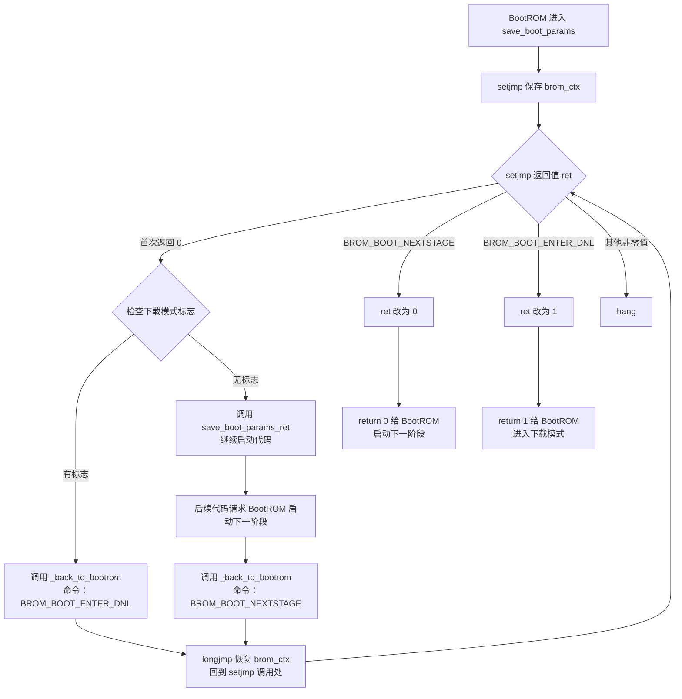

# Rockchip启动引导

## 1. 参考链接

[Boot option - Rockchip open source Document](https://opensource.rock-chips.com/wiki_Boot_option)‘

## 2. 启动流程

- 对于前级loader开源的代码，use U-Boot TPL/SPL from upsream or rockchip U-Boot。
- 对于前级loader闭源代码，use Rockchp idbLoader which is combinded by Rockchip ddr init bin and miniloader bin from Rockchip [rkbin project](https://github.com/rockchip-linux/rkbin);

## 3. 启动流程注意事项

1. 如果loader1包含多个阶段，程序将返回到bootrom，由bootrom加载并运行下一阶段。例如，如果loader1包含tpl和spl，则bootrom首先运行到tpl，tpl初始化DDR后返回bootrom，然后bootrom再加载并运行到spl。
2. 如果启用了可信功能，loader1需要加载可信固件和U-Boot，然后以安全模式（ARMv8中的EL3）进入可信固件，由可信固件完成初始化后，再以非安全模式（ARMv8中的EL2）跳转到U-Boot运行。
3. 对于trust（在trust.img或u-boot.itb中），armv7只有一个tee.bin，无论是否包含ta，而armv8则有bl31.elf以及**可选的**bl32。
4. 在 boot.img 中，内容可以是 zImage 及其 Linux 的 dtb，也可以选择是 grub.efi，也可以是 AOSP boot.img，ramdisk 是可选选项。

### 3.1 `save_boot_params()` 返回 BootROM 的流程

首次执行 `setjmp` 时，`ret = 0`，进入正常启动分支。`_back_to_bootrom()` 通过 `longjmp` 恢复现场后，`setjmp` 再次返回，此时 `ret` 是请求 BootROM 执行的命令。`switch` 将命令改成 BootROM 约定的函数返回值；把 `ret` 改回 `0` 不会重新进入 `case 0`。

`longjmp` 的实现还规定：如果传给它的返回值是 `0`，恢复后的 `setjmp` 返回值会变为 `1`。

### 3.2 TPL、SPL 与 U-Boot 的运行位置

当前 SDK 同时包含开源 TPL/SPL 构建入口和 `rkbin` 提供的 DDR bin/loader；实际启动链以打包并烧录的镜像为准。

| 阶段 | 代码运行位置 | 主要工作 |
|---|---|---|
| BootROM | 芯片内部 ROM | 加载并启动前级镜像 |
| TPL | SRAM，`CONFIG_TPL_TEXT_BASE=0xfff81000` | `tpl.c` 调用 `sdram_init()`；此 SDK 的 RK3506 实现仅返回 `-1`，未完成 DDR 初始化 |
| SPL | DDR，`CONFIG_SPL_TEXT_BASE=0x03f00000` | 加载后续镜像；自身不做代码重定位 |
| U-Boot 本体 | DDR，`CONFIG_SYS_TEXT_BASE=0x00200000` | 早期初始化后，按需在 DDR 内重定位 |

通用 TPL/SPL 模型会由前级初始化 DDR，再加载 SPL；但在此 SDK 中，`drivers/ram/rockchip/sdram_rk3506.c` 的 TPL `sdram_init()` 只是返回 `-1` 的占位实现，不能据此认定开源 TPL 已完成 DDR 初始化。`rkbin/RKBOOT/RK3506MINIALL.ini` 则将 `rk3506_ddr_750MHz_v1.04.bin` 配为 `FlashData`，并为后级设置 `LOAD_ADDR=0x3f00000`。`CONFIG_SPL_TEXT_BASE=0x03f00000` 与该加载地址一致；eMMC 的 `offset` 是存储位置，不是运行地址。该地址等于 63 MiB，距 64 MiB 边界还有 1 MiB；目前未找到解释最初为何选择此数值的官方资料。

#### 3.2.1 编译产物与打包输入

`make` 可以生成 `tpl/u-boot-tpl.bin` 和 `spl/u-boot-spl.bin`，但编译成功不代表这两个文件都被装入实际启动镜像。RK3506 的 `rkbin/RKBOOT/RK3506MINIALL.ini` 默认指定 `FlashData=rk3506_ddr_750MHz_v1.04.bin` 和 `FlashBoot=rk3506_spl_v1.10.bin`。

| 打包选项 | 前级 `FlashData` | 后级 `FlashBoot` |
|---|---|---|
| 不指定 `--tpl` / `--spl` | `rkbin` DDR bin | `rkbin` SPL |
| 只指定 `--spl` | `rkbin` DDR bin | 当前构建的 U-Boot SPL |
| 只指定 `--tpl` | 当前构建的 U-Boot TPL | `rkbin` SPL |
| 指定 `--tpl --spl` | 当前构建的 U-Boot TPL | 当前构建的 U-Boot SPL |

`make.sh` 的 `pack_idblock()` 按参数覆盖 `FlashData`/`FlashBoot`；`scripts/spl.sh` 也分别在有 `--tpl` 和 `--spl` 时替换对应输入。因此，不指定 `--tpl` 是“没有使用编译出的 TPL”，不是打包后再自动替换它。纯 U-Boot TPL+SPL 路径要求 TPL 先完成 DDR 初始化；当前 SDK 的 RK3506 `sdram_init()` 仍是返回 `-1` 的占位实现，不能凭现有源码完成这一步。

### 3.3 从 `s_init` 到 `_main`

`s_init` 比 `_main` 更早执行，只允许做绝对必要的初始化：此时不能依赖 DRAM、GD（`global_data`）、BSS 或控制台。对于采用 SPL 的板子，通用注释建议 `s_init` 为空，把早期初始化放在 SPL 的 `board_init_f()` 中。调用前的 `push {ip, lr}` 保存 `ip` 中传来的旧返回地址和当前返回地址；`bl s_init` 会改写 `lr`；`pop {ip, pc}` 恢复 `ip` 并返回。

`start.S` 跳入 `crt0` 的 `_main` 后，按以下顺序建立 C 运行环境：

1. 在当时可用的内存中准备临时栈和 GD，并在调用 `board_init_f()` 前清零 GD。GD 是专门准备的早期数据结构；普通全局变量和 BSS 此时仍不可用。
2. 调用 `board_init_f()` 做早期硬件准备，并在 GD 中记录后续需要的地址，例如新栈、GD 位置和重定位目标。具体是否需要初始化 DDR，由当前启动阶段决定。
3. U-Boot 本体切换到安排好的栈和 GD，再调用 `relocate_code()` 搬移自身；SPL 不进行代码重定位。
4. 清零 BSS，建立可写数据等完整 C 环境，然后进入 `board_init_r()`；U-Boot 本体还会在此之前执行需要的 CPU 运行环境设置。SPL 是否搬移栈和 GD，取决于 `CONFIG_SPL_STACK_R` 等配置。

注释中“DRAM 可能尚不可用”是通用约束：有的板子由 SPL 在 SRAM 中初始化 DDR。若当前 RK3506 启动镜像已将 SPL 加载到 `0x03f00000` 执行，DDR 必须在此之前可用；具体由哪个前级程序初始化，应以实际镜像为准。临时栈和 GD 的位置仍须看具体配置，不能由 SPL 代码地址推断。

U-Boot 本体不会执行 `arch/arm/mach-rockchip/tpl.c` 的 `board_init_f()`：该文件在 Makefile 中由 `obj-tpl-y += tpl.o` 限定为 TPL。U-Boot 本体进入 `common/board_f.c` 的 `board_init_f()`；其初始化序列调用 `arch/arm/mach-rockchip/sdram.c` 的 `dram_init()`，解析已有 DDR 信息并写入 `gd->ram_size`，而不是重新训练 DDR。

### 3.4 相关配置宏和 `r9`

| 宏 | 含义 |
|---|---|
| `CONFIG_SPL_BUILD` | 构建早期引导镜像时的编译标记；本工程的 TPL/SPL 构建都会定义它 |
| `CONFIG_SPL_FRAMEWORK` | 启用 `common/spl/` 通用 SPL 框架的 Kconfig 选项 |
| `CONFIG_SPL_DM` | 在 SPL 中启用 U-Boot Driver Model（驱动模型）的配置选项 |

ARM 版 U-Boot 通常用 `r9` 保存 GD 指针。早期汇编按配置处理它：定义 `CONFIG_SPL_DM` 时先执行 `mov r9, #0`；否则，SPL 用 `ldr r9, =gdata` 指向静态对象，U-Boot 本体用 `sub sp, sp, #GD_SIZE` 在栈上留空间、`bic sp, sp, #7` 做 8 字节对齐，再用 `mov r9, sp` 指向该空间。`r9=0` 只表示这段代码尚未提供有效 GD 指针，不表示驱动模型不需要 GD；在使用 GD 前必须完成有效初始化。

------

# Arm Trustzone

## 4. 详细介绍

[Arm Trustzone与ATF安全介绍 - 一篇就够了_arm atf-CSDN博客](https://blog.csdn.net/u012294613/article/details/132412275)

[【ATF】TF-A概述 - Emma1111 - 博客园](https://www.cnblogs.com/Wangzx000/p/17792870.html)

## 5. ARMv7和ARMv8的区别

### 5.1 关于 ARMv7的`tee.bin`

ARMv7 架构（仅支持到 EL3 以下特权级，无 EL3 完整安全监控器设计）的可信功能实现更简洁：

- `tee.bin`通常整合了**安全监控器**（类似 ARMv8 的 BL31 功能）和**可信执行环境内核**（类似 BL32 的 OP-TEE 核心），因为 ARMv7 的 TrustZone 实现没有强制区分 EL3 和 Secure EL1 的严格分层。
- 无论是否包含 TA（Trusted Application，用户态安全应用），`tee.bin`都是单一镜像：不含 TA 时仅提供基础安全服务（如加密、签名验证）；包含 TA 时则整合了用户态安全应用（如 DRM 模块）。
- 启动流程：loader1 加载`tee.bin`和 U-Boot 后，先进入`tee.bin`完成安全初始化（如内存隔离、安全外设配置），再切换到非安全模式（SVC 模式）启动 U-Boot。

### 5.2 关于 ARMv8 的 BL31 和 BL32

ARMv8 架构引入了严格的 EL3（最高安全特权级）和 EL2（非安全虚拟化级）分层，因此可信固件必须拆分：

- **BL31**：独占 EL3，负责安全监控（如 SMC 指令处理、特权级切换、中断路由），是安全世界的 “守门人”，不可省略。
- **BL32**：运行在 Secure EL1，通常是 OP-TEE 内核，提供具体安全服务（如密钥管理、TA 调度），根据安全需求可省略（若只需基础安全隔离，BL31 alone 即可）。
- 启动流程：loader1 先加载 BL31 到 EL3 执行，BL31 初始化后加载 BL32（若有），最后切换到 EL2 启动 U-Boot，全程严格遵循特权级隔离。

### 5.3 核心差异的根源

这种区别源于**架构设计的安全粒度**：

- ARMv7 的 TrustZone 更侧重 “安全 / 非安全世界隔离”，未对安全世界内部做细分，因此`tee.bin`可整合所有安全功能。
- ARMv8 则强化了安全世界的分层（EL3 vs Secure EL1）和非安全世界的虚拟化支持（EL2），必须通过 BL31 和 BL32 的拆分实现严格的权限管控。

