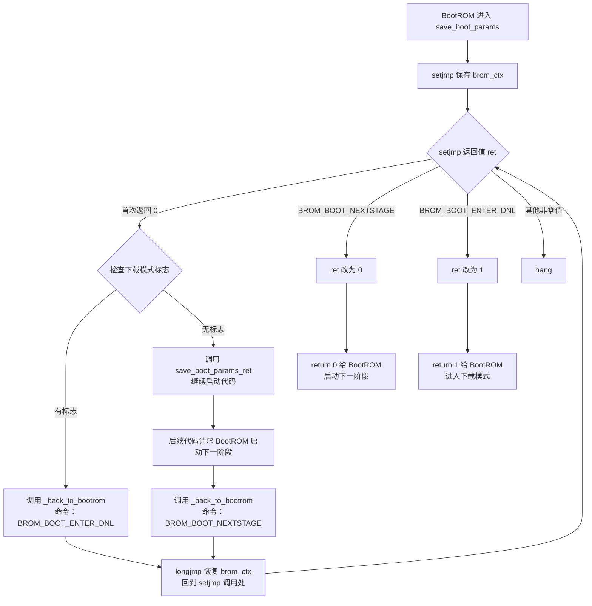

# Rockchip启动引导

## 1.官方参考链接

[Boot option - Rockchip open source Document](https://opensource.rock-chips.com/wiki_Boot_option)‘

## 2.启动流程

- 对于前级loader**开源**的代码

  ```shell
  use U-Boot TPL/SPL from upsream or rockchip U-Boot。
  ```
- 对于前级loader**闭源**代码

  ```shell
  use Rockchp idbLoader which is combinded by Rockchip ddr init bin and miniloader bin from Rockchip 
  ```

   [rkbin project](https://github.com/rockchip-linux/rkbin)

## 3.重点内容

后续章节将根据以下几点重点展开分析：

- 如果加载程序1有多个阶段，程序会返回bootrom和bootrom加载，进入下一阶段。例如，如果 loader1 是 tpl 和 spl，bootrom 会先运行到 tpl，tpl init DDR 再回到 bootrom，再启动 bootrom，然后加载并运行 SPL。
- 如果启用了可信功能，loader1需要加载可信固件和U-Boot，然后以安全模式（ARMv8中的EL3）进入可信固件，由可信固件完成初始化后，再以非安全模式（ARMv8中的EL2）跳转到U-Boot运行。
- 对于trust（在trust.img或u-boot.itb中），armv7只有一个tee.bin，无论是否包含ta，而armv8则有bl31.elf以及**可选的**bl32。
- 在 boot.img 中，内容可以是 zImage 及其 Linux 的 dtb，也可以选择是 grub.efi，也可以是 AOSP boot.img，ramdisk 是可选选项。

# 返回BootROM

## 1.返回流程

[Rockchip Boot option 文档](https://opensource.rock-chips.com/wiki_Boot_option)说明：当前级镜像包含多个阶段时，前级会返回 BootROM，由 BootROM 加载并运行下一阶段；例如 TPL 初始化 DDR 后返回，BootROM 再加载 SPL。该文档解释了交接流程，但没有说明为何专门选用 `0` 和非零作为返回值。



首次执行 `setjmp` 时，`ret = 0`，进入正常启动分支。`_back_to_bootrom()` 通过 `longjmp` 恢复现场后，`setjmp` 再次返回，此时 `ret` 是请求 BootROM 执行的命令。`longjmp` 的实现还规定：如果传给它的返回值是 `0`，恢复后的 `setjmp` 返回值会变为 `1`。

## 2.返回原理

从**执行顺序**看，是 `start.S` 的 `reset` 跳进 `save_boot_params()`；但从**返回地址**看，`start.S` 没有成为它的函数调用者，因为用的是 `b`，不是 `bl`：

```asm
reset:
    b save_boot_params       @ 只跳转，不修改 lr
save_boot_params_ret:
```

`bl save_boot_params` 才会把下一条指令 `save_boot_params_ret` 的地址写入 `lr`；实际的 `b` 不写 `lr`。因此，`save_boot_params_ret` **不是** `save_boot_params()` 执行 `return ret` 时自动返回的地址。对这条代码路径，前级进入时保留的 BootROM 返回现场才用于最终返回。

```text
BootROM 进入前级 → start.S: reset → b save_boot_params
  → setjmp 首次返回 0
  → C 代码主动调用 save_boot_params_ret()，继续执行 start.S 后续代码
  → back_to_bootrom() 调用 longjmp
  → 回到 save_boot_params() 的 setjmp，进入非零命令分支
  → return ret，恢复原始调用现场并返回 BootROM
```

# 各阶段运行

## 1.各阶段作用

| 阶段 | 代码运行位置 | 主要工作 |
|---|---|---|
| BootROM | 芯片内部 ROM | 加载并启动前级镜像 |
| TPL | SRAM，`CONFIG_TPL_TEXT_BASE=0xfff81000` | `tpl.c` 调用 `sdram_init()`；此 SDK 的 RK3506 实现仅返回 `-1`，未完成 DDR 初始化 |
| SPL | DDR，`CONFIG_SPL_TEXT_BASE=0x03f00000` | 加载后续镜像；自身不做代码重定位 |
| U-Boot 本体 | DDR，`CONFIG_SYS_TEXT_BASE=0x00200000` | 早期初始化后，按需在 DDR 内重定位 |

通用 TPL/SPL 模型会由前级初始化 DDR，再加载 SPL；但在此 SDK 中，`drivers/ram/rockchip/sdram_rk3506.c` 的 TPL `sdram_init()` 只是返回 `-1` 的占位实现，不能据此认定开源 TPL 已完成 DDR 初始化。

## 2.编译产物与打包

`make`可以生成 `tpl/u-boot-tpl.bin` 和 `spl/u-boot-spl.bin`，但编译成功不代表这两个文件都被装入实际启动镜像。RK3506 的 `rkbin/RKBOOT/RK3506MINIALL.ini` 默认指定 `FlashData=rk3506_ddr_750MHz_v1.04.bin` 和 `FlashBoot=rk3506_spl_v1.10.bin`。

| 打包选项 | 前级 `FlashData` | 后级 `FlashBoot` |
|---|---|---|
| 不指定 `--tpl` / `--spl` | `rkbin` DDR bin | `rkbin` SPL |
| 只指定 `--spl` | `rkbin` DDR bin | 当前构建的 U-Boot SPL |
| 只指定 `--tpl` | 当前构建的 U-Boot TPL | `rkbin` SPL |
| 指定 `--tpl --spl` | 当前构建的 U-Boot TPL | 当前构建的 U-Boot SPL |

## 3.使用闭源rkbin

U-Boot 官方 [Rockchip 文档的 TPL 小节](https://github.com/u-boot/u-boot/blob/master/doc/board/rockchip/rockchip.rst#tpl) 写道：

> For some SoCs U-Boot sources lack of support to inizialize DRAM.
> In these cases, to get a fully functional image following PackageWithTPLandSPL, use DDR binary provided by Rockchip rkbin repository as ROCKCHIP_TPL when building U-Boot.

这段话描述的是**通用处理方式**：源码没有 DRAM 初始化实现时，可以将 rkbin 的 DDR 二进制程序作为 TPL 阶段使用。

------

# Arm Trustzone

## 4. 详细介绍

[Arm Trustzone与ATF安全介绍 - 一篇就够了_arm atf-CSDN博客](https://blog.csdn.net/u012294613/article/details/132412275)

[【ATF】TF-A概述 - Emma1111 - 博客园](https://www.cnblogs.com/Wangzx000/p/17792870.html)

## 5. ARMv7和ARMv8的区别

### 5.1 关于 ARMv7的`tee.bin`

ARMv7 架构（仅支持到 EL3 以下特权级，无 EL3 完整安全监控器设计）的可信功能实现更简洁：

- `tee.bin`通常整合了**安全监控器**（类似 ARMv8 的 BL31 功能）和**可信执行环境内核**（类似 BL32 的 OP-TEE 核心），因为 ARMv7 的 TrustZone 实现没有强制区分 EL3 和 Secure EL1 的严格分层。
- 无论是否包含 TA（Trusted Application，用户态安全应用），`tee.bin`都是单一镜像：不含 TA 时仅提供基础安全服务（如加密、签名验证）；包含 TA 时则整合了用户态安全应用（如 DRM 模块）。
- 启动流程：loader1 加载`tee.bin`和 U-Boot 后，先进入`tee.bin`完成安全初始化（如内存隔离、安全外设配置），再切换到非安全模式（SVC 模式）启动 U-Boot。

### 5.2 关于 ARMv8 的 BL31 和 BL32

ARMv8 架构引入了严格的 EL3（最高安全特权级）和 EL2（非安全虚拟化级）分层，因此可信固件必须拆分：

- **BL31**：独占 EL3，负责安全监控（如 SMC 指令处理、特权级切换、中断路由），是安全世界的 “守门人”，不可省略。
- **BL32**：运行在 Secure EL1，通常是 OP-TEE 内核，提供具体安全服务（如密钥管理、TA 调度），根据安全需求可省略（若只需基础安全隔离，BL31 alone 即可）。
- 启动流程：loader1 先加载 BL31 到 EL3 执行，BL31 初始化后加载 BL32（若有），最后切换到 EL2 启动 U-Boot，全程严格遵循特权级隔离。

### 5.3 核心差异的根源

这种区别源于**架构设计的安全粒度**：

- ARMv7 的 TrustZone 更侧重 “安全 / 非安全世界隔离”，未对安全世界内部做细分，因此`tee.bin`可整合所有安全功能。
- ARMv8 则强化了安全世界的分层（EL3 vs Secure EL1）和非安全世界的虚拟化支持（EL2），必须通过 BL31 和 BL32 的拆分实现严格的权限管控。

